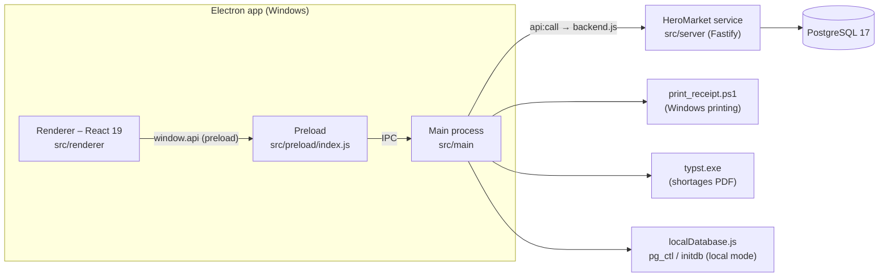
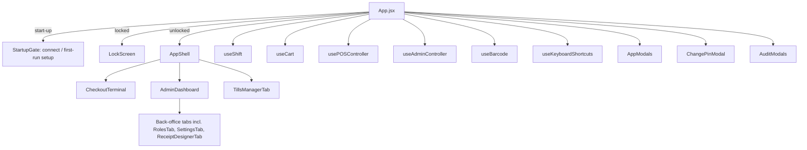

# Architecture

HeroMarket POS is an Electron desktop application whose data lives in PostgreSQL behind the **HeroMarket service**. This page covers processes, boundaries and the main data flows. Database topics (schema, deployment modes, outages, backup) are in [DATABASE_ARCHITECTURE.md](DATABASE_ARCHITECTURE.md).

## 1. Summary



| Process / module                 | Responsibility                                                                                                                                                                                                      |
| -------------------------------- | ------------------------------------------------------------------------------------------------------------------------------------------------------------------------------------------------------------------- |
| Renderer (`src/renderer/src`)    | UI only. Calls `api(op, body)` (`lib/api.js`); never sees SQL, database credentials or the session token.                                                                                                           |
| Preload (`src/preload/index.js`) | Exposes `window.api`: `call`, `backend.status/configure`, `db.backup/restore`, `printer.print/printSale/printReport/saleToPdf/testTemplate`, shortages PDF.                                                         |
| Main (`src/main`)                | Window, IPC, the service connection (`backend.js`), the managed local PostgreSQL (`localDatabase.js`), printing (`printer.js`), PDFs, backups to disk (`dataIpc.js`), single-instance lock.                         |
| Service (`src/server`)           | 90 named operations in 12 modules (`modules/*.js`): validation, permissions, business rules, transactions, audit log. Runs in-process (local and standalone modes) or as a network server (`cli.js serve`, Docker). |
| Shared (`src/shared`)            | Code used by main, renderer and service: `receipt.mjs` (receipt templates and both outputs), `reportLines.mjs` (printed reports), `legacyReceiptText.mjs` (legacy HTML-receipt converter).                          |

## 2. Main process (`src/main`)

| File                             | What it does                                                                                                                                                                                                                                               |
| -------------------------------- | ---------------------------------------------------------------------------------------------------------------------------------------------------------------------------------------------------------------------------------------------------------- |
| `index.js`                       | Single-instance lock, window creation (no navigation, no new windows), IPC registration, shortages PDF (Typst), start of the backend on ready, clean stop on quit (`before-quit` waits for the local database to stop)                                     |
| `userDataPath.js`                | Data folder: `%APPDATA%\HeroMarket` (packaged), `%APPDATA%\HeroMarket-dev` (development), or `HEROMARKET_USER_DATA`. Locates the pre-PostgreSQL database for the import.                                                                                   |
| `backend.js`                     | Reads and writes `heromarket.json` (atomic, `.bak`), starts the mode (local / standalone / client), imports legacy data once, forwards operations with the token and terminal name, revokes the previous session on login, maps connection failures to 503 |
| `localDatabase.js`               | Creates, starts and stops the private cluster (local mode), with the safety rules in DATABASE_ARCHITECTURE.md §3.1                                                                                                                                         |
| `dataIpc.js`                     | `api:call`, `backend:status` (waits for start-up), `backend:configure`, `backup:save` / `backup:restore` (safety export before restore)                                                                                                                    |
| `printer.js`, `printSettings.js` | `print-sale` / `print-template-test` (templates → line language → PowerShell), `print-report` (shift, Momkn, wallets), `sale-pdf` (A4 → PDF), legacy `print-receipt` (HTML sale receipts)                                                                  |

## 3. Service (`src/server`)

- **`app.js#createService`** builds the Fastify app, the pool and the `operation()` registry:
  - Each operation is `POST /api/<name>` with a JSON schema.
  - Each declares `permission` / `anyPermission`, or is marked `public` (only `auth.status`, `auth.setup`, `auth.login`).
  - Handlers receive `ctx`: `pool`, `user`, `can`, `require`, `tx`, `audit`, `ip`, `terminal`, `secret`, `setupCode`.
- **Modules:** `auth`, `shifts`, `pos`, `sales`, `catalog`, `customers`, `finance` (suppliers, cheques, expenses, damaged goods), `tills`, `reports`, `admin` (users, roles, logs, reset), `settings` (settings, receipt templates) and `backup`.
- **Errors** (`errors.js`): trigger messages (Arabic) → 409; unique and foreign-key violations → friendly 409; bad input → 400; lost connections → 503.
- **Database** (`db/`): `pool.js` (types, time zone, transactions), `migrate.js` + `migrations/`, `legacy-import.js`.
- **Auth** (`auth/`): `permissions.js` (catalogue, built-in roles), `pin.js` (HMAC + scrypt), `access.js` (role bootstrap, user description).
- **CLI** (`cli.js`): `serve`, `migrate`, `health`, with `*_FILE` secrets and a setup code.

## 4. Renderer (`src/renderer/src`)

### 4.1 Composition

`main.jsx` mounts `<ErrorBoundary><App/></ErrorBoundary>`. `App.jsx` is the composition root and state owner:



Start-up (`App.jsx#checkStartup`):

1. `backend.status`, which waits for the main process to finish starting.
2. If the backend is not configured or not reachable: StartupGate **connect** (three device roles).
3. If no users exist: StartupGate **setup** (first administrator, plus the setup code on a networked server).
4. Otherwise the **lock screen**.

A 503 during start-up is retried for about 30 s.

### 4.2 Navigation (unchanged contract)

There is no router: `currentView` (`'pos' | 'tills' | 'admin'`) and `adminTab` decide the screen. Each navigation item lists the permissions that show it (`shell/navigation.js`, `canOpenTab`), and `useBarcode` routes scanner input by these values.

### 4.3 State and data access

- Plain React state in custom hooks.
- All data goes through `lib/api.js#api(op, body)`, which throws an `ApiError` (status, code, Arabic message). A 401 fires `heromarket:session-expired` and the app returns to the lock screen.
- UI services: `triggerCustomAlert`, `triggerCustomConfirm`, `setToastMessage`.

## 5. Data flow: scanning a product to a committed sale

```mermaid
sequenceDiagram
  participant S as Scanner
  participant UI as CheckoutTerminal / useBarcode
  participant M as Main (backend.js)
  participant SV as Service (pos module)
  participant DB as PostgreSQL
  S->>UI: barcode + Enter
  UI->>M: api('pos.lookup', {codes})
  M->>SV: POST /api/pos.lookup (token, terminal)
  SV->>DB: SELECT … FROM products WHERE barcode = ANY($1)
  SV-->>UI: product (cost hidden unless products.view_cost)
  UI->>UI: cart (useCart)
  UI->>M: api('pos.checkout', {clientRef, shiftId, items, discount, payment…}) on F1
  M->>SV: POST /api/pos.checkout
  SV->>DB: BEGIN; advisory lock(clientRef); products FOR UPDATE; recompute prices & totals; INSERT sale RETURNING id; INSERT items; ledgers; COMMIT
  SV-->>UI: {saleId, total, change}
  UI->>M: printer.printSale(data) → active template → print_receipt.ps1
```

If a retry carries the same `clientRef`, it returns the stored sale. A price that changed or was tampered with is refused, and stock or trigger errors roll the whole sale back.

## 6. Error handling

- **Service:** every error has the shape `{ error: { code, message } }` with an HTTP status. Database errors are mapped; unexpected errors are logged with the stack and returned as a generic 500.
- **Renderer:** `ApiError` messages are shown through `triggerCustomAlert` or toasts. `ErrorBoundary` catches render crashes.

## 7. Known limits

- No offline queue in client mode (G-20).
- Plain HTTP between tills and server (G-24).
- Electron 39 advisories (G-15).
- Renderer not code-split (G-19).
- Receipt printing depends on Windows PowerShell and System.Drawing.

See [GAP_ANALYSIS.md](GAP_ANALYSIS.md) and [TESTING_AND_KNOWN_ISSUES.md](TESTING_AND_KNOWN_ISSUES.md).
