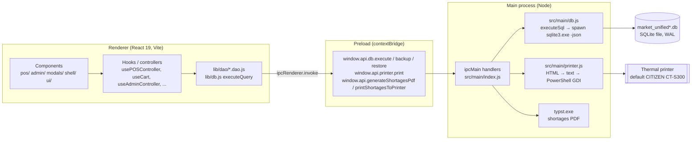
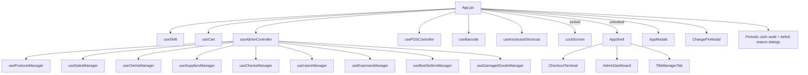

# Architecture

> Status: verified against source on 2026-10-13 (commit `6b7c838` + HeroMarket redesign branch).
> Legend used throughout `.docs`: **Verified** = read in code and/or observed running · **Inferred** = reasonable reading of code, not exercised · **Unknown** = could not be established.

## 1. Summary

HeroMarket POS is a **single-window Electron desktop application** for Windows. It has three layers:

| Layer        | Runtime                    | Entry point                                                         | Responsibility                                                                            |
| ------------ | -------------------------- | ------------------------------------------------------------------- | ----------------------------------------------------------------------------------------- |
| Main process | Node.js inside Electron 39 | `src/main/index.js`                                                 | Window lifecycle, IPC handlers, SQLite bridge, printing, PDF generation, backup/restore   |
| Preload      | Isolated bridge            | `src/preload/index.js`                                              | Exposes `window.api` (db / printer / shortages) and `window.electron` via `contextBridge` |
| Renderer     | Chromium + React 19        | `src/renderer/index.html` → `src/renderer/src/main.jsx` → `App.jsx` | The entire UI **and almost all business logic** (SQL is composed in the renderer)         |

There is **no HTTP server and no ORM**. The renderer builds SQL strings and sends them to the main process over IPC (`execute-sql`); the main process pipes them into a bundled `sqlite3.exe` CLI process (`-json` mode) and parses the JSON output. (Verified)



## 2. Main process (`src/main`)

### `index.js` (Verified)

- In packaged builds, replaces `console.*` with a writer to `%APPDATA%/<app>/app.log` (reset when older than 24h).
- `createWindow()` – 1200×800 `BrowserWindow`, `autoHideMenuBar`, `contextIsolation: true`, `nodeIntegration: false`, `sandbox: false`. Loads the Vite dev server URL in dev (`ELECTRON_RENDERER_URL`) or `out/renderer/index.html` in production.
- On `app.whenReady()`: sets the App User Model ID, calls `initializeDatabase()` and `initializePrinter()`, registers IPC handlers (see `API_AND_INTEGRATIONS.md`).
- `execute-sql` handler applies a regex deny-list (`DROP TABLE`, `ALTER TABLE`, `ATTACH/DETACH DATABASE`, `DELETE FROM users`) before forwarding SQL. **This is the only server-side guard**; every other statement composed by the renderer is executed.

### `db.js` (Verified)

- Resolves `sqlite3.exe` from `process.cwd()` in dev and `process.resourcesPath` when packaged.
- **Database path**: dev → `<cwd>/market_unified_testing.db` (overridable with `HEROMARKET_DB_PATH`, added in the redesign for disposable QA databases); packaged → `%APPDATA%/<productName>/market_unified.db`, seeded on first run by copying `resources/market_unified.db` if present.
- `initializeDatabase()` runs idempotent `CREATE TABLE IF NOT EXISTS` for auxiliary tables, indexes, default `settings`, additive `ALTER TABLE ... ADD COLUMN` migrations (errors swallowed), and three integrity triggers. **It does not create the core tables** `users`, `products`, `shifts`, `sales`, `sale_items` – those must already exist in the shipped database (see `DATA_MODEL.md`, and `scripts/init-dev-db.js` for dev).
- `executeSql(sql)` spawns **one `sqlite3.exe` process per call**, prepends `PRAGMA foreign_keys = ON; PRAGMA busy_timeout = 10000;`, writes the SQL to stdin, then extracts the **last** JSON array from stdout. A multi-statement script (e.g. a `BEGIN … COMMIT` checkout) is therefore atomic per call. `last_insert_rowid()` is meaningless across calls because each call is a new connection.

### `printer.js` (Verified)

- `print-receipt` IPC: reads `store_name`, `branch_name`, `printer_name` from `settings`, **parses the receipt HTML with regexes** (labels such as `الإجمالي`, `المدفوع`, `الباقي للعميل`) into a 48-column text layout and runs `resources/print_receipt.ps1` via PowerShell. Resolves only when the script prints `PRINT_DONE`.
- Consequence: the receipt HTML produced by `lib/printTemplates.js` is a **contract** with these regexes. Changing its labels breaks printing.

## 3. Preload (`src/preload/index.js`) (Verified)

Exposes exactly:

```js
window.api = {
  db: { execute(sql), backup(), restore() },
  printer: { print(html, options) },
  generateShortagesPdf(items),
  printShortagesToPrinter(items)
}
window.electron = electronAPI // @electron-toolkit/preload
```

## 4. Renderer (`src/renderer/src`)

### 4.1 Composition

`main.jsx` mounts `<ErrorBoundary><App/></ErrorBoundary>` in `StrictMode` and silences `console.*` in production builds.

`App.jsx` is the **composition root and state owner**. It wires hooks together and passes very wide prop lists down:



### 4.2 Navigation model (Verified)

There is **no router**. Navigation is two pieces of React state in `App.jsx`:

- `currentView`: `'pos' | 'tills' | 'admin'`
- `adminTab`: `'menu' | 'stats' | 'inventory' | 'shifts' | 'sales' | 'clients' | 'suppliers' | 'checks' | 'expenses' | 'damaged' | 'bestsellers' | 'users' | 'reordering' | 'backup' | 'advanced-stats' | 'cashier-performance' | 'logs' | 'tills'`

These values are load-bearing: `useBarcode` routes scanner keystrokes by `currentView === 'pos'` and `currentView === 'admin' && adminTab === 'inventory'`. The redesigned sidebar keeps these exact values (see `FRONTEND_ARCHITECTURE.md`).

### 4.3 State management (Verified)

Plain React `useState` inside custom hooks. No context, no external store. Cross-hook communication is via callbacks passed as arguments (e.g. `usePOSController` receives `fetchStats`, `setToastMessage`, `triggerCustomAlert`). Application-wide UI services:

- `triggerCustomAlert(message, title?, onClose?)` and `triggerCustomConfirm(message, onConfirm, onCancel?, title?)` – non-blocking dialogs (native `window.alert` is overridden to route here).
- `setToastMessage(string | {text, type})` – transient toast.

### 4.4 Data access (Verified)

`lib/db.js#executeQuery(sql)` calls `window.api.db.execute`; outside Electron it falls back to `lib/mockDb.js` (a tiny regex-driven fake used for browser-only previews). Two styles coexist:

1. **Inline SQL in hooks** (the majority: `usePOSController`, `use*Manager`).
2. **DAO modules** in `lib/dao/*.dao.js` – used by `useShift` (`getActiveShift`), `useUsersManager`/`usePOSController` (`logEvent`), tills hooks (`momkn.dao`, `mobile_money.dao`) and `LogsTab`. Several DAO functions are unused duplicates of hook logic (e.g. `sales.dao#createSaleTransaction`).

All values are interpolated into SQL strings; string values pass through `escapeSql` (single-quote doubling). Numeric values are generally `parseFloat`-ed first.

## 5. Data flow: scanning a product to a committed sale

```mermaid
sequenceDiagram
  participant Scanner as USB scanner (keyboard wedge)
  participant UB as useBarcode (global keydown)
  participant CT as CheckoutTerminal input
  participant PC as usePOSController
  participant Cart as useCart
  participant Main as main/db.js
  Scanner->>UB: fast keystrokes (≤35ms apart)
  UB->>CT: focus + write value into barcode input
  Scanner->>CT: Enter → form submit
  CT->>PC: handleBarcodeSubmit()
  PC->>Main: SELECT * FROM products WHERE barcode IN (raw, stripped, padded)
  alt not found
    PC->>PC: parseScaleBarcode (prefix 20/21/22/25) → lookup
  end
  PC->>Cart: addToCart(product, qty)
  Note over Cart: cart lines {barcode,name,price,cost_price,qty,unit,total}
  CT->>PC: F1 / "تأكيد الدفع" → handleCheckout()
  PC->>Main: optional client lookup/insert
  PC->>Main: BEGIN; INSERT sales; INSERT sale_items + UPDATE stock (per line); client/ledger updates; COMMIT
  PC->>Main: logEvent(checkout_sale)
  PC->>Main: print-receipt (unless "no receipt" toggled)
  PC->>Cart: reset cart + payment state, refocus scanner
```

## 6. Error handling (Verified)

- Main: IPC handlers log and rethrow; renderer receives `Error invoking remote method …`.
- Renderer: most handlers `try/catch` and surface Arabic messages via `triggerCustomAlert`, mapping SQLite messages through `utils#getFriendlyErrorMessage`. Many read paths only `console.error`.
- `ErrorBoundary` catches render-time crashes and offers reload. Event-handler exceptions are not caught by it.
- DB triggers enforce: non-negative stock, no sales on closed shifts, one open shift per user.

## 7. Weaknesses and technical debt (Verified unless marked)

1. **SQL composed in the renderer** with string interpolation; the main-process deny-list is the only guard. Any renderer compromise = full DB access.
2. **Process-per-query** SQLite access: high latency (~tens of ms per call), no prepared statements, no connection-scoped `last_insert_rowid()`; code uses `SELECT MAX(id)` instead (race-prone, see `docs/issues/critical_issues.md` C-02).
3. **Core schema not created by the app** (`users/products/shifts/sales/sale_items` must pre-exist).
4. **Receipt printing depends on regex-parsing HTML labels** (fragile coupling between `printTemplates.js` and `printer.js`).
5. **God components / wide prop drilling**: `App.jsx` and `useAdminController` pass 100+ props; `{...adminController}` is spread into children.
6. **Duplicate logic** between hooks and DAOs (shift cash math is re-implemented in `App.jsx`, `usePOSController`, `TillsManagerTab`, `CloseShiftModal`).
7. **Hard-coded identity**: a specific username (`'سيف فايز'`) changes tills visibility; store name strings are hard-coded in several places alongside the `settings` table.
8. **Large single JS bundle** (~1.3 MB) – no code splitting.
9. Pre-existing runtime defects are catalogued in `TESTING_AND_KNOWN_ISSUES.md`.
