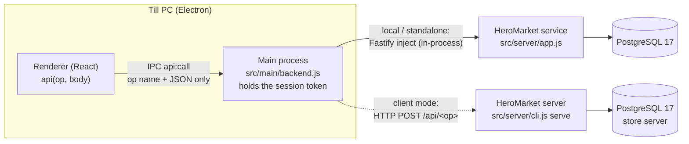

# Database Architecture

HeroMarket POS stores all data in **PostgreSQL 17**. Only the **HeroMarket service** (`src/server`) connects to the database. Terminals call the service. The renderer never sees SQL, database credentials or session tokens. The decisions are D-026 (PostgreSQL) and D-027 (service owns the database); the options compared are in [GAP_ANALYSIS.md §1](GAP_ANALYSIS.md).

## 1. Components



| Layer         | Code                                                         | Responsibility                                                                                                                                                         |
| ------------- | ------------------------------------------------------------ | ---------------------------------------------------------------------------------------------------------------------------------------------------------------------- |
| Renderer      | `src/renderer/src/lib/api.js`                                | `api('pos.checkout', {...})`. Raises `ApiError` with status and code; a 401 fires `heromarket:session-expired`.                                                        |
| Preload / IPC | `src/preload/index.js`, `src/main/dataIpc.js`                | `api:call` accepts only an operation name (`/^[a-zA-Z]+\.[a-zA-Z]+$/`) and a JSON body.                                                                                |
| Main          | `src/main/backend.js`                                        | Starts or connects the service, stores the session token in memory, adds `authorization` and `x-heromarket-terminal`, and revokes the previous session on a new login. |
| Service       | `src/server/app.js`, `src/server/modules/*.js`               | 89 named operations, each `POST /api/<op>` with a JSON schema. Every operation checks permissions and writes audit rows server-side.                                   |
| Data access   | `src/server/db/pool.js`                                      | One `pg` pool (max 10, idle 30 s, connect timeout 5 s). Queries are parameterised. `withTransaction` runs BEGIN/COMMIT/ROLLBACK.                                       |
| Schema        | `src/server/db/migrations/*.sql`, `src/server/db/migrate.js` | Numbered SQL files with checksums, recorded in `schema_migrations`, applied under an advisory lock, one transaction per file.                                          |

## 2. Schema

The 19 tables of the original application are ported one-to-one: same names, columns, keys, foreign keys and triggers (`0001_legacy_schema.sql`). They are listed in [DATA_MODEL.md](DATA_MODEL.md). Later migrations add:

| Migration                      | Adds                                                                                                                                                                                                                                                                                                                    |
| ------------------------------ | ----------------------------------------------------------------------------------------------------------------------------------------------------------------------------------------------------------------------------------------------------------------------------------------------------------------------- |
| `0002_access_control.sql`      | `roles`, `role_permissions`, `sessions` (stores only the token's SHA-256), and `receipt_templates` (`jsonb`, one active per paper size). `users` gains `role_id`, `pin_lookup` (unique HMAC key), `pin_hash` (scrypt), `is_active`, `created_at` and `updated_at`. `sales` gains `client_ref` (unique idempotency key). |
| `0003_permission_catalog.sql`  | `permission_catalog`: a permission introduced by a release is granted once to the built-in roles that include it by default, and never re-added after an administrator removes it.                                                                                                                                      |
| (runtime) `legacy_import_runs` | Created by the importer: source path, SHA-256, status and the full report.                                                                                                                                                                                                                                              |

**Types.**

- Money and quantities: SQLite `REAL` becomes `numeric`. Values are copied exactly; the parser returns JS numbers to the app, as before.
- Local date-times: `timestamp without time zone`, holding the store's local time as the original app wrote it.
- Dates: `date`.
- Every connection runs `SET TIME ZONE '<store zone>'`, so `LOCALTIMESTAMP` matches the old local-time text. The `pg` parsers return timestamps as the stored text and never convert them through the machine's time zone.

**Integrity.**

- The three business triggers are ported to plpgsql: stock cannot go negative, no sale on a closed shift, shift checks.
- Foreign keys are enforced.
- Checkout locks the product rows `FOR UPDATE` in a fixed order. With `pg_advisory_xact_lock(hashtext(client_ref))` and the unique `client_ref`, a retried checkout returns the same sale and is never recorded twice.
- Collation is `C` (byte order), so sorting matches the old SQLite `BINARY` ordering. Encoding is UTF-8 (Arabic).

## 3. Deployment modes

| Mode (`heromarket.json` → `mode`)   | Who                                                       | Where the database runs                                                   | How the till reaches it                          |
| ----------------------------------- | --------------------------------------------------------- | ------------------------------------------------------------------------- | ------------------------------------------------ |
| `local`: "هذا الجهاز فقط" (default) | One-till store; every new or upgraded install             | Private cluster created by the app (`src/main/localDatabase.js`)          | In-process                                       |
| `standalone`: "خادم قاعدة بيانات"   | The store's main PC, or a PC next to a managed PostgreSQL | Any PostgreSQL 17 (`databaseUrl`)                                         | In-process                                       |
| `client`: "جهاز كاشير"              | Extra tills in a multi-till store                         | The store server (`docker compose up`, or `node src/server/cli.js serve`) | HTTP on the LAN (`serverUrl`, default port 8787) |

### 3.1 Local mode (managed PostgreSQL)

The installer ships the PostgreSQL 17 server binaries in `resources/pgsql`. They are taken from `@embedded-postgres/windows-x64`, without the pgAdmin GUI libraries (about 85 MB unpacked).

On first start the app:

1. Picks a free port from 54330 and a random 24-byte password, and saves both in `heromarket.json` **before** running `initdb`. If the first start is interrupted, the same credentials finish the job later.
2. Runs `initdb` (UTF-8, `C` locale, scram-sha-256) in `%APPDATA%\HeroMarket\pgdata`. If the Windows profile path contains characters outside ASCII (for example an Arabic user name), it uses `%ProgramData%\HeroMarket\store-<hash>` instead. The PostgreSQL tools cannot open such paths: Windows passes them in the ANSI code page.
   The PostgreSQL tools themselves also need an ASCII path: if the app is installed under a non-ASCII profile (default per-user install), they are copied once to `%ProgramData%HeroMarket
untimepgsql-<version>` and run from there (`src/main/pgPaths.js`, K-34).
3. Starts the server with `pg_ctl start -w`, listening on `127.0.0.1` only. `pg_ctl` drops administrator rights itself, so this works on admin accounts.
4. Creates the `heromarket` database, runs the migrations, imports the earlier version's SQLite data once (see [DATABASE_MIGRATION.md](DATABASE_MIGRATION.md)), and starts the service in-process.

On quit the app stops the server with `pg_ctl stop -m fast` before exiting. If the app crashed, the next start finds the server still running and reuses it.

Safety rules in `localDatabase.js` / `backend.js`:

- A cluster is never re-initialised.
- If the credentials exist but the cluster is gone, the app stops with a message instead of creating an empty database.
- `heromarket.json` is written atomically (temporary file, `fsync`, rename) and the previous version is kept as `.bak`.
- A single-instance lock stops two copies from sharing, and stopping, one cluster.
- Development builds use `%APPDATA%\HeroMarket-dev` and never touch an installed store's data.

### 3.2 Multi-till store (server)

```
                ┌───────────── store LAN ─────────────┐
  Till 1 ──┐    │                                     │
  Till 2 ──┼──► HeroMarket server :8787 ──► PostgreSQL 17 (not exposed)
  Till 3 ──┘    │   (Docker: docker-compose.yml)      │
                └─────────────────────────────────────┘
```

- `docker-compose.yml` runs `db` (PostgreSQL 17, volume `pgdata`, no published port) and `server` (`Dockerfile.server`: non-root, read-only filesystem, all capabilities dropped, health-checked). See [DOCKER.md](DOCKER.md).
- Without Docker: install PostgreSQL 17 on the server PC, create a `heromarket` database and role, then run `node src/server/cli.js serve` with `HEROMARKET_DATABASE_URL` and `HEROMARKET_SECRET` (for example as a Windows service with NSSM).
- Each till picks **جهاز كاشير** and enters `http://<server-ip>:8787`. Tills never hold database credentials.
- First start of an empty server prints a **one-time setup code** in its log. The first administrator can only be created with it, so nobody else on the LAN can claim the store.
- **Transport:** plain HTTP on the store LAN. Session tokens travel in clear text inside the LAN. Put the server behind a TLS reverse proxy (Caddy or nginx with an internal certificate) if the network is shared. This is open item G-24 in [GAP_ANALYSIS.md](GAP_ANALYSIS.md).

## 4. Outages: what keeps working

| Event                                      | Local mode                                                                                                                            | Multi-till (client mode)                                                                                               |
| ------------------------------------------ | ------------------------------------------------------------------------------------------------------------------------------------- | ---------------------------------------------------------------------------------------------------------------------- |
| **Internet down**                          | Nothing changes: the app never uses the internet                                                                                      | Nothing changes, as long as the LAN and server are up                                                                  |
| **Store network down / switch off**        | Not affected                                                                                                                          | Tills cannot sell: every operation returns 503 "تعذر الاتصال بخادم HeroMarket". There is no offline queue (see below). |
| **Server PC / PostgreSQL stopped**         | The app restarts its own cluster on the next start                                                                                    | All tills stop until the server is back                                                                                |
| **Power cut during a sale**                | The sale transaction is committed or absent, never half-written (PostgreSQL WAL)                                                      | Same. The till may retry with the same `client_ref`, which returns the stored sale without recording it twice.         |
| **Lost connection (sleep, network reset)** | The pool drops dead connections. A failed operation returns 503 and the start screen retries for about 30 s (`App.jsx#checkStartup`). | Same                                                                                                                   |

**Offline selling is not implemented.** In client mode a till cannot record sales while the server is unreachable. Checkout is idempotent (`client_ref`), so an offline queue can be added later without risking duplicate sales. Until then a store that needs to sell through LAN outages should run its main till in local mode. This is open item G-20.

## 5. Backup and restore

- **In the app** (`backup.manage` permission), النسخ الاحتياطي:
  - `backup.export` writes a JSON file with every table (`format: 'heromarket-backup'`, the schema version and all rows).
  - `backup.restore` checks the format and that the schema version matches. It first saves a safety export to `%APPDATA%\HeroMarket\backups\pre-restore-*.json`, replaces all data in one transaction, resets the sequences and signs everyone out.
- **On a server:** schedule `pg_dump -Fc heromarket` (for example `docker compose exec db pg_dump -U heromarket -Fc heromarket > backup.dump`) and keep copies off the machine. Restore with `pg_restore` into an empty database.
- **The server secret must be kept with the backups.** `HEROMARKET_SECRET`, or `secret` in `heromarket.json`, keys the PIN lookup. After a restore under a different secret, each user's first login re-keys their PIN automatically (scan fallback in `auth.js`). Nothing is lost, but that first login is slower.

## 6. Configuration reference

| Setting                                                                                                                                              | Where                                  | Notes                                                        |
| ---------------------------------------------------------------------------------------------------------------------------------------------------- | -------------------------------------- | ------------------------------------------------------------ |
| `mode`, `databaseUrl`, `serverUrl`, `terminalName`                                                                                                   | `%APPDATA%\HeroMarket\heromarket.json` | Written by the connection screen (`backend:configure`)       |
| `local.{dir,port,password,initialised}`                                                                                                              | same file                              | Managed cluster; never shown to the renderer                 |
| `secret`                                                                                                                                             | same file                              | Generated once (32 random bytes), standalone and local modes |
| `HEROMARKET_DATABASE_URL[_FILE]`, `HEROMARKET_SECRET[_FILE]`, `HEROMARKET_TIMEZONE`, `HOST`, `PORT`, `HEROMARKET_SETUP_CODE`, `HEROMARKET_LOG_LEVEL` | Server environment                     | `src/server/cli.js`; `*_FILE` reads Docker secrets           |
| `HEROMARKET_DB_NAME`, `HEROMARKET_LOCAL_DB`, `HEROMARKET_USER_DATA`, `HEROMARKET_SERVER_URL`                                                         | Development                            | See [DEVELOPMENT_SETUP.md](DEVELOPMENT_SETUP.md)             |

## 7. Performance (measured)

Measured on 2026-10-14 on the development laptop (4 cores, PostgreSQL 17 local). The store was seeded with **20,000 products, 2,000 customers and 30,000 sales (90,000 lines)**. Timings are through the real service operations, in milliseconds:

| Operation                                     | p50     | p95      |
| --------------------------------------------- | ------- | -------- |
| Barcode scan (`pos.lookup`)                   | 5.7     | 8.6      |
| Product search by name (`pos.searchProducts`) | 8.7     | 11.3     |
| Customer search                               | 8.1     | 12.5     |
| Checkout, 5 lines (`pos.checkout`)            | 17      | 19.5     |
| Products page / with search                   | 15 / 85 | 18 / 186 |
| Invoices page                                 | 18.9    | 21.8     |
| Dashboard                                     | 24      | 30       |
| Monthly report (`reports.periodic`)           | 363     | 743      |
| Best sellers, month (`reports.bestSellers`)   | 1,116   | 1,530    |

The cashier paths stay under 20 ms. The back-office reports aggregate every sale line in the period and take up to about 1.5 s at this volume, which is acceptable for reports; materialised daily totals are a possible later optimisation. The probe script is kept with the QA evidence and not in the repository; the numbers above are its output.
