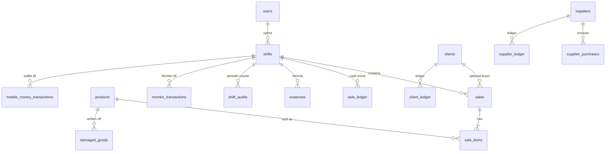

# Data Model

> Source of truth: `src/server/db/migrations/*.sql` (PostgreSQL 17). The 19 business tables keep the names and columns of the original SQLite schema (`0001_legacy_schema.sql`); `0002` and `0003` add access control, sessions, idempotency and receipt templates. Database architecture, deployment and backup: [DATABASE_ARCHITECTURE.md](DATABASE_ARCHITECTURE.md). No credentials or production data are included here.

## 1. Persistence

- **Engine**: PostgreSQL 17 (UTF-8, `C` collation), reached only by the HeroMarket service through one `pg` pool. Each connection runs `SET TIME ZONE '<store zone>'`.
- **Types**: money and quantities `numeric` (exact; parsed to JS numbers for the app), local date-times `timestamp without time zone` (store local time, returned as stored text), dates `date`, ids `integer` identities.
- **Schema versions**: `schema_migrations` (file name + checksum); migrations run on every service start under an advisory lock, one transaction per file. Never edit an applied migration – add a new one.
- **Where**: local mode `%APPDATA%\HeroMarket\pgdata` (managed cluster); standalone a PostgreSQL the store manages; server mode the Docker volume `pgdata`. Development: `.pgdata/` (`npm run pg:dev`).

## 2. Entity relationship overview

## 3. Tables

### Business tables (ported 1:1 from SQLite, `0001_legacy_schema.sql`)

| Table        | Key columns                                                                                                                                                                                                                               | Notes                                                                                                                                                       |
| ------------ | ----------------------------------------------------------------------------------------------------------------------------------------------------------------------------------------------------------------------------------------- | ----------------------------------------------------------------------------------------------------------------------------------------------------------- |
| `users`      | `id` PK, `username` UNIQUE, `password_hash`, `role` (`admin` \| `manager` \| `cashier`)                                                                                                                                                   | `password_hash` holds either a SHA-256 hex of the 4-digit PIN (new/edited users) **or the plain PIN** (legacy rows, dev seed). Login checks both.           |
| `products`   | `barcode` TEXT PK, `name`, `cost_price`, `retail_price`, `wholesale_price`, `stock_qty`, `reorder_limit`, `unit`, `category`                                                                                                              | `stock_qty ≤ reorder_limit AND reorder_limit > 0` ⇒ "low stock". `category` exists in dev schema; the UI does not edit it.                                  |
| `shifts`     | `id` PK, `user_id` FK, `start_time`, `end_time`, `initial_cash`, `expected_end_cash`, `actual_end_cash`, `difference`, `status` (`open`/`closed`), `momkn_start_balance`, `momkn_start_cash`, `vfcash_start_balance`, `vfcash_start_cash` | The last four are added by migrations.                                                                                                                      |
| `sales`      | `id` PK, `shift_id` FK, `user_id` (written by checkout since stage 2), `client_ref` UNIQUE (idempotency key), `timestamp`, `total_amount`, `original_amount`, `discount`, `payment_type`, `client_name`, `client_id` FK                   | `payment_type` values written by the UI: `نقدي`, `فودافون كاش`, `انستا باي`, `آجل`, `دفع جزئي`. `client_name` is a display string `name (phone) - address`. |
| `sale_items` | `id` PK, `sale_id` FK (CASCADE), `product_barcode` FK, `quantity`, `unit_price`, `total_price`, `cost_price`, `returned_qty`                                                                                                              | Returns mutate `returned_qty` and `total_price`.                                                                                                            |

### Business tables, continued

| Table                                                | Purpose                                                                                                                                                                                                                                               |
| ---------------------------------------------------- | ----------------------------------------------------------------------------------------------------------------------------------------------------------------------------------------------------------------------------------------------------- |
| `clients`                                            | Customer accounts. `debt_balance` > 0 = customer owes the store; < 0 = store holds customer credit. `points` loyalty (1 point per 100 EGP of net invoice). `phone` UNIQUE (empty phone stored as NULL, K-26).                                         |
| `client_ledger`                                      | Per-client movements; `type` ∈ `sale`, `payment` (UI writes these).                                                                                                                                                                                   |
| `suppliers`, `supplier_purchases`, `supplier_ledger` | Accounts payable. `supplier_ledger.type` ∈ `purchase`, `payment`.                                                                                                                                                                                     |
| `checks_register`                                    | Cheques in/out with `due_date` and `status` (`غير مسدد` / `مسدد`). Not linked to other tables.                                                                                                                                                        |
| `expenses`                                           | Operating expenses, mirrored as `safe_ledger` outflows.                                                                                                                                                                                               |
| `damaged_goods`                                      | Stock write-offs with cost snapshot.                                                                                                                                                                                                                  |
| `settings`                                           | Key/value: `store_name`, `branch_name`, `printer_name` (defaults inserted with `INSERT OR IGNORE`).                                                                                                                                                   |
| `shift_audits`                                       | Periodic drawer counts during a shift.                                                                                                                                                                                                                |
| `system_logs`                                        | Event log (`action_type` e.g. `shift_open`, `shift_close`, `checkout_sale`, `user_create`, `database_backup`, `system_reset`).                                                                                                                        |
| `momkn_transactions`                                 | "Momkn" bill-payment machine till: `digital_impact`, `cash_impact`, `commission`.                                                                                                                                                                     |
| `mobile_money_transactions`                          | Wallets/transfer till: `platform` ∈ `vodafone_cash`, `instapay`, `bank_transfer`.                                                                                                                                                                     |
| `safe_ledger`                                        | Drawer cash movements per shift: `type` ∈ `inflow`, `outflow`. **Outflow `description` prefixes are semantically significant** (`مرتجع…`, `إرجاع…`, `دفعة لمورد…`, `سداد دين مورد…`, `مصروفات…`) – reconciliation queries classify by `LIKE` on them. |

### Access control, sessions and templates (`0002`, `0003`)

| Table                | Purpose                                                                                                                               |
| -------------------- | ------------------------------------------------------------------------------------------------------------------------------------- |
| `roles`              | `key` (built-in roles; NULL for custom), `name` UNIQUE, `is_system`, `is_protected`                                                   |
| `role_permissions`   | (`role_id`, `permission`) PK; permission keys from `src/server/auth/permissions.js`                                                   |
| `permission_catalog` | Permission keys already offered to built-in roles (new ones granted once)                                                             |
| `sessions`           | `token_hash` (SHA-256) UNIQUE, `user_id`, `terminal`, `created_at`, `last_seen_at`, `expires_at` (12 h), `revoked_at`                 |
| `receipt_templates`  | `name` UNIQUE, `paper` ∈ 58mm/80mm/A4, `config` jsonb (block layout, D-032), `is_active` (one active per paper, partial unique index) |
| `schema_migrations`  | Applied migration files and checksums                                                                                                 |
| `legacy_import_runs` | Created by the importer: source path, SHA-256, status, full parity report                                                             |

Settings keys (`settings` table, validated by `settings.update`): `store_name`, `branch_name`, `store_address`, `store_phone`, `store_logo` (PNG data URL), `printer_name`, `default_opening_cash`, `audit_enabled`, `audit_interval_minutes`, `audit_idle_seconds`, `print_receipt_default`, `receipt_paper`.

## 4. Indexes

`idx_sales_shift_id`, `idx_sales_client_id`, `idx_sale_items_sale_id`, `idx_sale_items_barcode`, `idx_safe_ledger_shift_id`, `idx_client_ledger_client_id`, `idx_supplier_ledger_supplier_id`, `idx_sales_timestamp`, `idx_system_logs_timestamp`, `users_pin_lookup_key` (unique, partial), `idx_sessions_user`, `sales_client_ref_key` (unique, partial), `receipt_templates_active_per_paper` (unique, partial).

## 5. Triggers (plpgsql, same rules as the original)

| Trigger                        | Rule                                                                                     |
| ------------------------------ | ---------------------------------------------------------------------------------------- |
| `prevent_negative_stock`       | `BEFORE UPDATE OF stock_qty ON products` – raises an Arabic error if `NEW.stock_qty < 0` |
| `prevent_sale_on_closed_shift` | `BEFORE INSERT ON sales` – raises if the shift is `closed`                               |
| `prevent_multiple_open_shifts` | `BEFORE INSERT ON shifts` – raises if the user already has an `open` shift               |

The service maps these (`P0001`) to HTTP 409 with the trigger's message. The legacy import disables them only for the historic copy.

## 6. Transactions

Every multi-statement operation runs in one service transaction (`ctx.tx`): checkout (products locked `FOR UPDATE` in barcode order, advisory lock on `client_ref`), returns, repayments, supplier purchases and payments, expenses, damaged goods, till movements, shift close, settings and template changes, user and role changes, backup restore, system reset. Audit rows are written inside the same transaction where the change happens.

## 7. Development and test data

- `npm run pg:dev` creates `heromarket` and `heromarket_test` (empty; the app asks for the first administrator).
- Tests create and drop their own databases.
- `npm run db:legacy-fixture` builds an **SQLite** file in the original format with sample data (users with legacy PINs `1234`, `9999`, `1111`, `5555`) for import tests – it is never used by the app directly.

## 8. Backup and recovery

See [DATABASE_ARCHITECTURE.md §5](DATABASE_ARCHITECTURE.md): in-app JSON export/restore (one transaction, safety copy, same schema version required) and `pg_dump` on servers.
