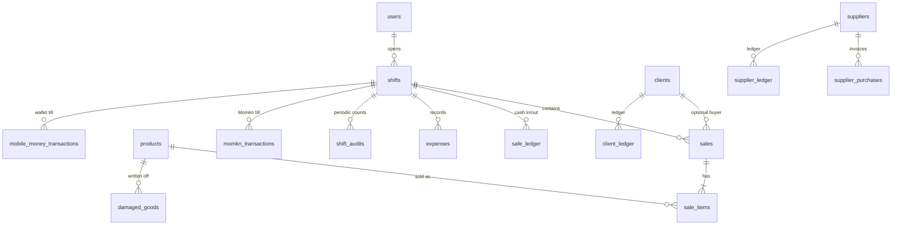

# Data Model

> Source of truth: `src/main/db.js#initializeDatabase` (auxiliary tables, migrations, triggers) and `scripts/init-dev-db.js` (full schema used for development/CI databases). The legacy description in `docs/DATABASE.md` is consistent but incomplete (it omits `sale_items.total_price`, `sales.client_name`, tills tables).
> No credentials or production data are included here.

## 1. Persistence mechanism

- **Engine**: SQLite 3 file accessed through the bundled `sqlite3.exe` CLI (`-json` output), one process per query (`src/main/db.js#executeSql`).
- **Journal**: `PRAGMA journal_mode=WAL` set at startup; every call also sets `foreign_keys = ON` and `busy_timeout = 10000`.
- **Files**

| Environment                 | Path                                                         | Created by                                                                                                                                             |
| --------------------------- | ------------------------------------------------------------ | ------------------------------------------------------------------------------------------------------------------------------------------------------ |
| Development (`npm run dev`) | `<repo>/market_unified_testing.db` (or `HEROMARKET_DB_PATH`) | `node scripts/init-dev-db.js` (core schema + sample data); `initializeDatabase()` adds the rest                                                        |
| Packaged app                | `%APPDATA%/<productName>/market_unified.db`                  | Copied on first launch from `resources/market_unified.db` (an `extraResources` entry in `electron-builder.yml`); **the file is not in the repository** |
| Legacy tests                | `tests/temp_test.db`                                         | `tests/db_helper.js#setupTestDb` copies the production DB, or bootstraps a fresh one via `scripts/init-dev-db.js` when none exists                     |

`*.db` is git-ignored. Never commit a real database.

## 2. Entity relationship overview

## 3. Tables

### Core (must pre-exist; created in dev by `scripts/init-dev-db.js`)

| Table        | Key columns                                                                                                                                                                                                                               | Notes                                                                                                                                                       |
| ------------ | ----------------------------------------------------------------------------------------------------------------------------------------------------------------------------------------------------------------------------------------- | ----------------------------------------------------------------------------------------------------------------------------------------------------------- |
| `users`      | `id` PK, `username` UNIQUE, `password_hash`, `role` (`admin` \| `manager` \| `cashier`)                                                                                                                                                   | `password_hash` holds either a SHA-256 hex of the 4-digit PIN (new/edited users) **or the plain PIN** (legacy rows, dev seed). Login checks both.           |
| `products`   | `barcode` TEXT PK, `name`, `cost_price`, `retail_price`, `wholesale_price`, `stock_qty`, `reorder_limit`, `unit`, `category`                                                                                                              | `stock_qty ≤ reorder_limit AND reorder_limit > 0` ⇒ "low stock". `category` exists in dev schema; the UI does not edit it.                                  |
| `shifts`     | `id` PK, `user_id` FK, `start_time`, `end_time`, `initial_cash`, `expected_end_cash`, `actual_end_cash`, `difference`, `status` (`open`/`closed`), `momkn_start_balance`, `momkn_start_cash`, `vfcash_start_balance`, `vfcash_start_cash` | The last four are added by migrations.                                                                                                                      |
| `sales`      | `id` PK, `shift_id` FK, `user_id` (not written by checkout), `timestamp`, `total_amount`, `original_amount`, `discount`, `payment_type`, `client_name`, `client_id` FK                                                                    | `payment_type` values written by the UI: `نقدي`, `فودافون كاش`, `انستا باي`, `آجل`, `دفع جزئي`. `client_name` is a display string `name (phone) - address`. |
| `sale_items` | `id` PK, `sale_id` FK (CASCADE), `product_barcode` FK, `quantity`, `unit_price`, `total_price`, `cost_price`, `returned_qty`                                                                                                              | Returns mutate `returned_qty` and `total_price`.                                                                                                            |

### Auxiliary (created by `initializeDatabase`)

| Table                                                | Purpose                                                                                                                                                                                                                                               |
| ---------------------------------------------------- | ----------------------------------------------------------------------------------------------------------------------------------------------------------------------------------------------------------------------------------------------------- |
| `clients`                                            | Customer accounts. `debt_balance` > 0 = customer owes the store; < 0 = store holds customer credit. `points` loyalty (1 point per 100 EGP of net invoice). `phone` UNIQUE.                                                                            |
| `client_ledger`                                      | Per-client movements; `type` ∈ `sale`, `payment` (UI writes these).                                                                                                                                                                                   |
| `suppliers`, `supplier_purchases`, `supplier_ledger` | Accounts payable. `supplier_ledger.type` ∈ `purchase`, `payment`.                                                                                                                                                                                     |
| `checks_register`                                    | Cheques in/out with `due_date` and `status` (`غير مسدد` / `مسدد`). Not linked to other tables.                                                                                                                                                        |
| `expenses`                                           | Operating expenses, mirrored as `safe_ledger` outflows.                                                                                                                                                                                               |
| `damaged_goods`                                      | Stock write-offs with cost snapshot.                                                                                                                                                                                                                  |
| `settings`                                           | Key/value: `store_name`, `branch_name`, `printer_name` (defaults inserted with `INSERT OR IGNORE`).                                                                                                                                                   |
| `shift_audits`                                       | Periodic drawer counts during a shift.                                                                                                                                                                                                                |
| `system_logs`                                        | Event log (`action_type` e.g. `shift_open`, `shift_close`, `checkout_sale`, `user_create`, `database_backup`, `system_reset`).                                                                                                                        |
| `momkn_transactions`                                 | "Momkn" bill-payment machine till: `digital_impact`, `cash_impact`, `commission`.                                                                                                                                                                     |
| `mobile_money_transactions`                          | Wallets/transfer till: `platform` ∈ `vodafone_cash`, `instapay`, `bank_transfer`.                                                                                                                                                                     |
| `safe_ledger`                                        | Drawer cash movements per shift: `type` ∈ `inflow`, `outflow`. **Outflow `description` prefixes are semantically significant** (`مرتجع…`, `إرجاع…`, `دفعة لمورد…`, `سداد دين مورد…`, `مصروفات…`) – reconciliation queries classify by `LIKE` on them. |

## 4. Indexes (Verified – `db.js`)

`idx_sales_shift_id`, `idx_sales_client_id`, `idx_sale_items_sale_id`, `idx_sale_items_barcode`, `idx_safe_ledger_shift_id`, `idx_client_ledger_client_id`, `idx_supplier_ledger_supplier_id`.

## 5. Triggers (Verified)

| Trigger                        | Rule                                                                           |
| ------------------------------ | ------------------------------------------------------------------------------ |
| `prevent_negative_stock`       | `BEFORE UPDATE OF stock_qty ON products` – rolls back if `NEW.stock_qty < 0`   |
| `prevent_sale_on_closed_shift` | `BEFORE INSERT ON sales` – rolls back if the shift is `closed`                 |
| `prevent_multiple_open_shifts` | `BEFORE INSERT ON shifts` – rolls back if the user already has an `open` shift |

## 6. Migrations

Additive, best-effort `ALTER TABLE … ADD COLUMN` statements at every startup with errors ignored; one backfill (`sales.original_amount`). There is no version table; migrations are idempotent by failure. (Verified)

## 7. Transaction boundaries (Verified)

Multi-statement operations are sent as **one** `executeSql` call wrapped in `BEGIN TRANSACTION; … COMMIT;`:
checkout, item return, full-sale return, client repayment, supplier purchase/repayment/deletion, expense add/delete, damaged goods add/delete, system reset. Anything outside one call (e.g. inserting a new client during checkout, logging events, `SELECT MAX(id)` follow-ups) is **not** atomic with the main transaction.

## 8. Seed / sample data

`scripts/init-dev-db.js` seeds 4 users (dev PINs `1234` admin, `9999` manager, `1111` / `5555` cashiers), 2 clients, 1 closed shift and 9 sample grocery products. Flags: `--reset` (delete and recreate), `--db <path>`.

## 9. Backup and recovery

- **Backup** (`backup-database` IPC): WAL checkpoint (`FULL`) then file copy to a user-chosen path.
- **Restore** (`restore-database` IPC): WAL checkpoint (`TRUNCATE`) then **overwrites** the live DB file with the chosen file; the app must be restarted. No validation that the chosen file is a HeroMarket DB.
- The close-shift flow offers a backup prompt before closing.
- Operational recommendation: keep dated backups off-machine; test a restore on a spare machine periodically (see `SECURITY_AND_RELEASE.md`).
