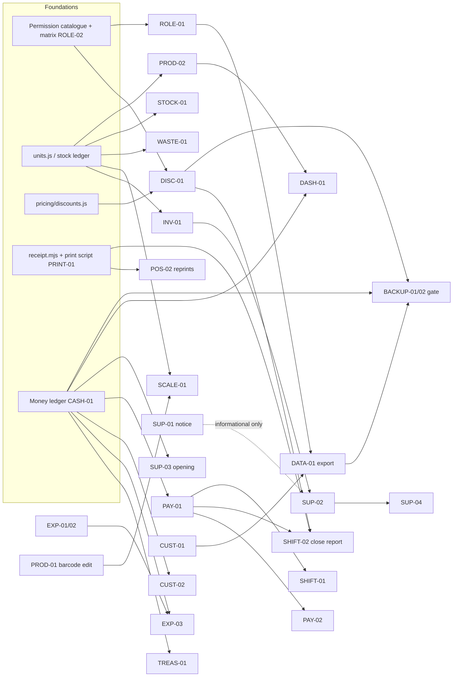

# Owner feedback: implementation plan

Written for whoever implements and reviews the owner's feedback, the developer and Claude. It turns `HeroMarket_Owner_Feedback_Specification.md` (the source of truth) into an audited, dependency-ordered plan. The live status of every task is in [OWNER_FEEDBACK_TASKS.md](OWNER_FEEDBACK_TASKS.md).

- **Audit date:** 2026-10-21, on `main` at f0f0d84 (1.4.0 merged, **not tagged or published**).
- **Work branch:** `feature/owner-feedback`. Nothing is merged, tagged, published or deployed without the owner's approval.

## 1. Sources and decisions

| Source                                                           | Status                                                                                                                                                                                                                                                                                                                                                                                                                                                                                                                                                          |
| ---------------------------------------------------------------- | --------------------------------------------------------------------------------------------------------------------------------------------------------------------------------------------------------------------------------------------------------------------------------------------------------------------------------------------------------------------------------------------------------------------------------------------------------------------------------------------------------------------------------------------------------------- |
| Specification `.docs/HeroMarket_Owner_Feedback_Specification.md` | Read in full; the requirement IDs below are its IDs.                                                                                                                                                                                                                                                                                                                                                                                                                                                                                                            |
| Reference A, receipt photo                                       | `.docs/reference-images/owner-sales-receipt.jpg`: the original, kept **out of git** because it shows a customer's name and phone. `owner-sales-receipt-redacted.jpg` is committed.                                                                                                                                                                                                                                                                                                                                                                              |
| Reference B, scale label                                         | `.docs/reference-images/owner-scale-label.jpg` (no personal data).                                                                                                                                                                                                                                                                                                                                                                                                                                                                                              |
| **DISC-01: manual fixed-amount invoice discount**                | **Approved by the owner on 2026-10-21** (spec option B), recorded as D-057. It replaces the "no operator discounts" part of D-044 for users holding the new permission only. Automatic rules (D-044) stay unchanged.                                                                                                                                                                                                                                                                                                                                            |
| **Owner answers 2026-10-21 (D-059, D-060)**                      | Expenses: each user sees only their own. Treasury may go below zero, shown in red. Supplier notice amount = amount paid, informational. Scale labels: one layout for all (7-digit product code `2000001`, 5-digit grams, EAN-13 check digit). Midnight backup approved: 00:00 daily, no confirmation, 14 daily + 8 weekly in `%ProgramData%\HeroMarket\backups`. Cheques: out of navigation and workflows, records kept, archive for administrators only. Version 1.5.0, 1.4.0 not published first. Supplier invoice discount: proportional, largest remainder. |
| Earlier rules still in force                                     | D-041 (stock = sum of movements, moving average, negative stock allowed), D-044 (automatic discounts and their allocation), D-045 (≤ 2 phones), D-046 (passwords, approvals, temporary passwords), D-050 (≤ 3 addresses), D-054 (who must open a shift), D-055 (measurement kinds), D-056 (import).                                                                                                                                                                                                                                                             |
| Conflict found: D-038                                            | D-038 left the shift-close formula "pending an owner decision". CASH-01 and PAY-01 now give that decision: an opening float comes from the treasury, cash at close goes to the treasury, and expected amounts stay hidden until the cashier confirms. The money phase implements this and closes D-038.                                                                                                                                                                                                                                                         |

## 2. Repository baseline

- **Stack:** Electron 43, React 19, a Fastify service in-process, PostgreSQL 17 embedded and run as a Windows service, numbered SQL migrations `0001`–`0014`, and node:test (258 tests passing on `main`).
- **Money:**
  - `safe_ledger` is the **per-shift drawer** ledger; every row needs a shift.
  - Momkn and wallet tills have their own tables.
  - **There is no treasury.**
  - Sales have **one** `payment_type`: نقدي, فودافون كاش, انستا باي, آجل or دفع جزئي (cash + credit). **There is no Visa/card.**
- **Stock:** immutable `stock_movements` with a cached `products.stock_qty`. Packaging units (`product_units`, factor and own barcodes and prices) already exist (0005). Measurement kinds were added in 0014.
- **Discounts:** automatic rules only (`pricing/discounts.js`). Each line keeps its `line_discount` and `cart_discount` shares, and `sale_discounts` keeps the rules applied. Checkout refuses any manual discount (403).
- **Printing:** `resources/print_receipt.ps1` draws the line language built by `src/shared/receipt.mjs` with GDI+. **No string format sets right-to-left direction, and table and label/value columns are laid out left to right.**
- **Data lifecycle:**
  - backup and restore of all tables (`modules/backup.js`, same schema version only);
  - installer-run migrations with a verified pre-install copy and integrity checks (UPDATE_GUIDE.md);
  - Excel import of products, customers and suppliers (D-056). **No export exists.**

## 3. Audit: what exists, what is missing

Status: **Exists** (meets the requirement; verify and close) · **Partial** · **Missing** · **Broken** (exists, wrong result) · **Conflict**.

| ID                                   | Status                     | Evidence in the code                                                                                                                                                                                                                                         | Gap to close                                                                                                                                                                              |
| ------------------------------------ | -------------------------- | ------------------------------------------------------------------------------------------------------------------------------------------------------------------------------------------------------------------------------------------------------------ | ----------------------------------------------------------------------------------------------------------------------------------------------------------------------------------------- |
| DATA-01 export                       | Missing                    | Import only: `modules/storeImport.js`, `shared/storeImport.mjs`                                                                                                                                                                                              | Export products, customers and suppliers in the **same template**; a version marker; round-trip test                                                                                      |
| INV-01 packages                      | **Exists / Partial**       | `product_units` (factor, barcodes, prices, sellable/purchasable), sale and purchase lines snapshot the unit and factor, stock in base units                                                                                                                  | A warning plus explicit confirmation when a factor changes; acceptance tests for the exact owner scenario (10×10, sell 2 boxes = 20 pieces, change factor to 12)                          |
| SUP-01 supplier notice               | Missing                    | —                                                                                                                                                                                                                                                            | New table and workflow, informational only                                                                                                                                                |
| CASH-01 drawer ↔ treasury            | Missing / Conflict (D-038) | `safe_ledger` per shift only; opening cash is only a number on `shifts`                                                                                                                                                                                      | Treasury ledger; opening float moves treasury → drawer; close moves drawer → treasury                                                                                                     |
| EXP-01 visibility                    | **Broken**                 | `expenses.list` returns **all** expenses to anyone with `expenses.manage`; `expenses` has no creator column                                                                                                                                                  | Add `created_by`; filter on the server                                                                                                                                                    |
| EXP-02 categories, optional note     | Partial                    | Fixed list in `ExpensesTab.jsx`; `description` required (`minLength 1`)                                                                                                                                                                                      | Category table and screen; optional note                                                                                                                                                  |
| EXP-03 admin expense without shift   | Missing                    | Trigger `require_open_shift` (0011) and `ownOpenShift` refuse it                                                                                                                                                                                             | Treasury destination (needs CASH-01)                                                                                                                                                      |
| SUP-02 sale price, discount, posting | Partial                    | Purchase lines: qty, cost, unit; posting is immediate                                                                                                                                                                                                        | Sale price per line; invoice discount (amount or %) allocated to costs; draft → posted                                                                                                    |
| SUP-03 opening balance, contact edit | Partial                    | Opening balance via import only (D-056); **no `suppliers.update`**                                                                                                                                                                                           | Opening balance on create; edit contact and phone, audited                                                                                                                                |
| CUST-01 customer code                | Missing                    | Only `clients.id`                                                                                                                                                                                                                                            | Stable unique code, backfill, till search                                                                                                                                                 |
| CUST-02 debt payments without shift  | Missing                    | `clients.repay` and `suppliers.repay` need the user's open shift for cash                                                                                                                                                                                    | Treasury destination (needs CASH-01)                                                                                                                                                      |
| PROD-01 edit barcode                 | Missing                    | `products.barcode` is the primary key; `sale_items` and `damaged_goods` reference it **without** `ON UPDATE CASCADE`                                                                                                                                         | Rename with an alias; history must keep the code it was sold under                                                                                                                        |
| SCALE-01 scale labels                | **Partial**                | `parseScaleLabel` (units.js), off by default, settings screen; the sample parses to code `00001`, 0.125 kg                                                                                                                                                   | **No check-digit validation**; product lookup tries only `00001` and `1`, **not `2000001`**; unclear messages for invalid labels                                                          |
| PROD-02 valuation                    | Missing                    | —                                                                                                                                                                                                                                                            | Stock value at cost and at selling price                                                                                                                                                  |
| WASTE-01 search                      | Partial                    | `DamagedGoodsTab` takes a barcode only                                                                                                                                                                                                                       | Name search with the shared picker                                                                                                                                                        |
| STOCK-01 movements page              | Partial                    | `StockHistoryModal` per product                                                                                                                                                                                                                              | Top-level "حركات المخزون" with filters, same source                                                                                                                                       |
| DASH-01 snapshots                    | Missing                    | `dashboard.stats` gives counts only                                                                                                                                                                                                                          | Four owner-only values                                                                                                                                                                    |
| ANALYTICS-01 date filters            | **Broken**                 | `reports.periodic` selects **shifts that started** in the window (`shiftIdsSince`); "اليوم" = since **yesterday** 00:00 (`CURRENT_DATE - 1`)                                                                                                                 | Filter by the sale, expense or damage **timestamp** with calendar-day bounds                                                                                                              |
| POS-01 keyboard, 0.5, Esc, sign-out  | **Broken / Partial**       | Quantity input is bound to the cart value: typing "0" is rejected and the box snaps back to 1, so **0.5 cannot be typed**. **Esc clears the invoice without asking.** A required open-shift window (D-054) cannot be closed, so **the user cannot sign out** | Draft quantity text; Esc and the "تفريغ" button confirm; sign out from the shift window                                                                                                   |
| POS-02 receipt modes, reprints       | Partial                    | Per-sale "no receipt" toggle and sale reprint exist                                                                                                                                                                                                          | Explicit "طباعة بفاتورة / بدون فاتورة" actions; shift-close and supplier-invoice reprints                                                                                                 |
| PRINT-01 RTL printing                | **Broken**                 | Item table and spread label/value columns drawn left to right; no `DirectionRightToLeft` (photo: item name at the left, total at the right)                                                                                                                  | Structural right-to-left layout; preview-to-image for evidence                                                                                                                            |
| PAY-01 methods, blind close          | Missing / Conflict         | No Visa; `shifts.auditPreview` and `liveSummary` give the cashier the expected drawer **before** closing (the close window even offers "fill with expected")                                                                                                 | Payment methods; blind close; persisted closing snapshot                                                                                                                                  |
| PAY-02 change payment method         | Missing                    | —                                                                                                                                                                                                                                                            | Compensating correction, own permission                                                                                                                                                   |
| **DISC-01 manual discount**          | Missing (approved)         | Checkout refuses `discount > 0`                                                                                                                                                                                                                              | Own permission; amount and reason; after automatic rules; allocated to lines; shown in invoice, shift and close report                                                                    |
| USER-01 password characters          | Partial                    | `passwordProblem` **requires both letters and digits**                                                                                                                                                                                                       | Length, common-password and username checks only (any characters)                                                                                                                         |
| USER-02 admin reset                  | **Exists**                 | D-046: administrator reset gives a temporary password, ends the user's sessions, forces a change; recovery code; local reset command                                                                                                                         | Verify; add the administrator's own password confirmation                                                                                                                                 |
| ROLE-01 import permission            | Partial                    | The import needs products, customers and suppliers management together                                                                                                                                                                                       | Dedicated `data.import` and separate `data.export`                                                                                                                                        |
| NAV-01 drawer audit menu             | Exists (to remove)         | Topbar button "جرد الدرج", the periodic reminder and `shift_audits`                                                                                                                                                                                          | Remove the button; keep the data and the service                                                                                                                                          |
| NAV-02 cheques                       | Exists (to remove)         | `ChecksTab`, `checks.manage`, `checks_register`                                                                                                                                                                                                              | Hide the screen and menu item; keep the table and history                                                                                                                                 |
| SHIFT-01 shifts screen               | Partial                    | "سجل الورديات" lists closed shifts                                                                                                                                                                                                                           | Rename to "الورديات"; open and closed shifts with live details                                                                                                                            |
| SHIFT-02 close receipt               | Partial                    | A shift report prints at close; it cannot be reprinted                                                                                                                                                                                                       | Full report from a persisted snapshot; reprint                                                                                                                                            |
| TREAS-01 treasury                    | Missing                    | —                                                                                                                                                                                                                                                            | "الخزنة" page and ledger (with CASH-01)                                                                                                                                                   |
| CUST-02 / SUP-04                     | see above                  |                                                                                                                                                                                                                                                              |                                                                                                                                                                                           |
| BACKUP-01 scheduled backup           | Missing                    | Manual backup; pre-install copies                                                                                                                                                                                                                            | Built 2026-10-21: nightly Task Scheduler job (system account), the program's own format from one consistent snapshot (pg_dump is not bundled), 14 daily + 8 weekly; see NIGHTLY_BACKUP.md |
| BACKUP-02 gate                       | Exists (process)           | UPDATE_GUIDE.md §7 checklist; Sandbox runs                                                                                                                                                                                                                   | Apply to every migration in this work                                                                                                                                                     |
| ROLE-02 / UX-01 audits               | Missing                    | —                                                                                                                                                                                                                                                            | Permission matrix document; control inventory                                                                                                                                             |

## 4. Shared services: one source of truth each

| Concern               | Single source                                                              | Used by                                                                          |
| --------------------- | -------------------------------------------------------------------------- | -------------------------------------------------------------------------------- |
| Quantities and units  | `inventory/units.js` (`kindRule`, `toBaseQty`, `validateFactor`)           | sale, purchase, return, waste, count, import, scale labels                       |
| Stock                 | `inventory/stock.js` (`postMovement`, `receiveStock`, `adjustTo`)          | every stock change; reports read `stock_movements` and `products.stock_qty`      |
| Prices and discounts  | `pricing/discounts.js` (`priceCart`)                                       | `pos.price` preview, `pos.checkout`; manual discount added here (DISC-01)        |
| Money (after CASH-01) | one ledger service (planned `money/ledger.js`): drawer, treasury, cashless | checkout, returns, expenses, debt payments, shift open/close, reports, dashboard |
| Permissions           | `auth/permissions.js` catalogue, checked by `app.operation`                | every operation; the menu only hides                                             |
| Receipts              | `shared/receipt.mjs` (line language) + `print_receipt.ps1` (drawing)       | sale receipt, reprint, shift report, A4                                          |
| Data files            | `shared/storeImport.mjs` (template columns)                                | import, export (DATA-01), template download                                      |

## 5. Dependency graph

## 6. Migrations (classification per spec §8)

| Migration                         | Requirements                                                                | Kind                 | Notes                                                                                                                                                                                                                 |
| --------------------------------- | --------------------------------------------------------------------------- | -------------------- | --------------------------------------------------------------------------------------------------------------------------------------------------------------------------------------------------------------------- |
| —                                 | ANALYTICS-01, SCALE-01, POS-01, USER-01, EXP-02 (note), NAV-01/02, PRINT-01 | **Application only** | Scale settings gain a `checkDigit` field with a default; old JSON stays valid                                                                                                                                         |
| 0015 manual discounts             | DISC-01                                                                     | Schema               | `sale_discounts`: actor, reason and time columns; `sales.manual_discount` (default 0). No existing row changes                                                                                                        |
| 0016 money model                  | CASH-01, TREAS-01, PAY-01, EXP-01/02/03, CUST-02, SHIFT-02                  | Schema + data        | Treasury ledger, payment methods incl. Visa, closing snapshots, expense creator and categories. Backfill: expense creator from its shift; existing categories become rows; **no balance changes** (fingerprint check) |
| 0017 owner notes                  | SHIFT-01, PROD-01, PAY-02 (D-063)                                           | Schema               | Barcode edit cascades to history; correction note optional; returns keep their refund method                                                                                                                          |
| 0018 receivables and payables     | SUP-01, SUP-04, CUST-02, TREAS-01 (D-064)                                   | Schema + data        | Treasury method; movement kinds backfilled from texts; preliminary supplier invoices. No amount changes                                                                                                               |
| 0019 cancel, reclassify, packages | SUP-01, PAY-02, INV-01 (D-065)                                              | Schema               | Preliminary invoice cancellation, `supplier_refund` kind, corrections after close, package purchase price. No existing row changes                                                                                    |
| later                             | SUP-02, SUP-03, CUST-01                                                     | Schema               | Purchase discount and sale price; supplier opening balance; customer codes (numbers assigned when built)                                                                                                              |

Every migration:

- is forward only and runs in one transaction;
- is tested on a full-size copy and by the installer's Case B checks;
- is tested failing partway (the copy is put back);
- is verified by a backup → restore round trip into a disposable database.

## 7. Data lifecycle implications

- **Backup and restore:**
  - New tables must be added to `modules/backup.js#TABLES` in FK order.
  - Restore requires the same schema version, so a 1.4.0 backup restores only into 1.4.0. Document this in the release notes.
- **Import and export:**
  - The template columns live in one place (`shared/storeImport.mjs`).
  - A customer code (CUST-01) and package fields (INV-01) become **optional** template columns, so 1.4.0 files still import.
  - The export writes a version marker sheet.
- **Sync (cloud, not yet in use):** new tables need `sync_tables` rows and capture triggers, as in 0013 and 0014.
- **History:** no migration rewrites sales, stock movements, ledgers or closed shifts. Corrections are compensating rows.
- **Offline:** everything stays local to the store's service. Nothing new depends on the cloud.

## 8. Phases (revised order and why)

1. **Phase A: correctness fixes, no migration.** ANALYTICS-01, SCALE-01, POS-01 (0.5, Esc confirm, sign-out), USER-01, EXP-02 (optional note), NAV-01, NAV-02, the SHIFT-01 rename.
   - These are wrong results or blocked users today, they're unambiguous, and they don't touch the money model.
2. **Phase B: DISC-01** (migration 0015).
   - Approved, explicitly requested, and self-contained in pricing and checkout.
   - It must exist before the shift-close report (SHIFT-02) is redesigned, so the report shows it.
3. **Phase C: PRINT-01** (application only).
   - The receipt photo is a live defect at the shop.
   - Fixing the drawing pipeline first means later reports (SHIFT-02) are built on a correct base.
4. **Phase D: money model** (0016): CASH-01, TREAS-01, PAY-01, EXP-01/03, CUST-02, SHIFT-01/02, PAY-02.
   - One design, one migration, one reconciliation document (`FINANCIAL_RECONCILIATION.md`), because these share every formula.
5. **Phase E: purchasing** (0017): SUP-01/02/03/04 with INV-01 factor confirmation.
6. **Phase F: catalogue and reports:** CUST-01, PROD-01 (0018), PROD-02, WASTE-01, STOCK-01, DASH-01.
7. **Phase G: data lifecycle:** DATA-01, ROLE-01, BACKUP-01, the BACKUP-02 gate, ROLE-02 matrix, UX-01 inventory, POS-02 reprints.
8. **Phase H: release readiness:** version, release notes, Sandbox update tests (application-only and migration), the owner's manual checklist. Hardware tests stay pending until done at the shop.

The spec's suggested order puts the money model before purchasing and catalogue work; this plan keeps that. It moves Phase A–C first because they're independent of the money model, and A and C fix defects the owner is hitting now.

## 9. Version

- `main` holds 1.4.0, never tagged or published, and the shop doesn't run it yet.
- This work is **1.5.0**: migrations 0015+, so a Case B update over any 1.4.0 build.
- Repository history confirms it: the last tag is `v1.3.0-stable`, there is no 1.4.0 tag or release, and `package.json` on `main` says 1.4.0.
- **Owner decision (Q8, 2026-10-21):** plan toward 1.5.0; 1.4.0 is not published first. The bump to 1.5.0 is made on this branch before phase H.
- This is not approval to merge, tag, publish or deploy. Each of those waits for an explicit go-ahead.

## 10. Owner questions

All ten questions (Q2–Q10) are answered as of 2026-10-21; see [OWNER_FEEDBACK_TASKS.md § Owner decisions](OWNER_FEEDBACK_TASKS.md#owner-decisions). Nothing is blocked on the owner. Only the hardware checks (HW-01 scanner, HW-02 printer) wait for the shop.
