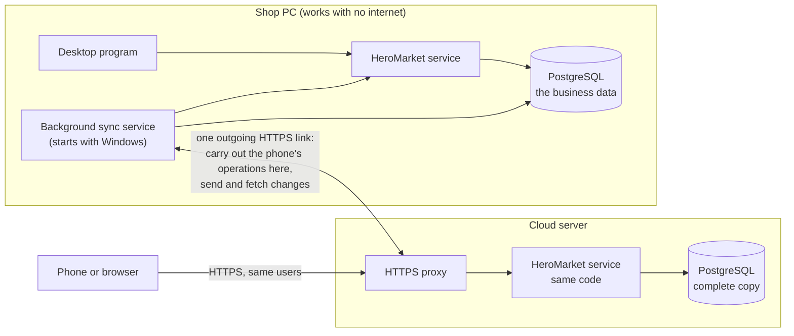

# Phase 2 architecture proposal: one HeroMarket, two ways in

Written for the owner. Revision 3, 2026-11-11, after the owner's clarification that cloud and desktop must be one business system with one set of accounts. It replaces revision 2 of the same day and §2–§6 of [PHASE2_DISCOVERY.md](PHASE2_DISCOVERY.md). Nothing here is implemented, deployed or bought. Every operation is listed in [PHASE2_CAPABILITY_MATRIX.md](PHASE2_CAPABILITY_MATRIX.md).

## 1. Summary

- **One business, one set of accounts.** There is no cloud drawer, cloud shift, cloud treasury or cloud rule. An operation started from the phone is the same operation, by the same user, on the same shift, drawer, treasury and balances as from the desktop.
- **While the shop is reachable (the normal case):** every change made from the phone is carried out **in the shop's database, by the shop's own code**, and the phone shows the result a second or two later. Both ways in look at the same state, and an operation is always checked against the shop's current data, never against an old copy.
- **While the shop is unreachable** (no internet, or the PC is off): the cloud carries out the same operation itself, with the same code, on its own complete copy. When the shop returns, the two are brought together automatically.
- **Bringing them together needs four plain rules** and one list for the rare cases a person must look at (§6).
- **What revision 2 had and this one drops:** shifts that belong to an environment, a labelled cloud drawer, one open shift per user per environment, and decisions that wait for their "home".
- **Unchanged from before:** security, the Windows background service, the phone interface, the hosting choice (about $5–8 per month) and the testing requirements.

## 2. What the code does today: the device plays no part

I read the shift, drawer, treasury, payment, return, expense and debt code again for this revision. No money operation asks which device or program it came from. Each decides its account from three things only: **who is signed in**, **which destination the screen asked for**, and **what that user is permitted**.

| Operation                       | How the account is chosen (as written today)                                                                                                                            | What is recorded                                                                       | Where                                                                |
| ------------------------------- | ----------------------------------------------------------------------------------------------------------------------------------------------------------------------- | -------------------------------------------------------------------------------------- | -------------------------------------------------------------------- |
| Open a shift                    | A shift for the signed-in user; one open shift per user                                                                                                                 | The shift; the opening float leaves the treasury once                                  | [shifts.js:446-489](../src/server/modules/shifts.js#L446-L489)       |
| Sale                            | The user's own shift, and it must be open                                                                                                                               | The sale in that shift; stock movements; the payment in that shift                     | [pos.js:572-574](../src/server/modules/pos.js#L572-L574)             |
| Customer return                 | First the customer's debt on that invoice, then store credit used on it, then cash from the user's own open shift, or the sale's shift if still open; otherwise refused | The return; stock back; the refund in that shift                                       | [sales.js:65-155](../src/server/modules/sales.js#L65-L155)           |
| Supplier payment                | The treasury if asked, or if no shift is named and the user manages the treasury; otherwise the user's open shift                                                       | Balance down, supplier ledger, and either a treasury entry or a movement in that shift | [finance.js:597-687](../src/server/modules/finance.js#L597-L687)     |
| Customer collection             | The same destination rule; refused when nothing is owed                                                                                                                 | Balance down, customer ledger, treasury entry or shift movement                        | [customers.js:419-491](../src/server/modules/customers.js#L419-L491) |
| Expense                         | The same destination rule                                                                                                                                               | The expense on the shift or on the treasury                                            | [finance.js:775-847](../src/server/modules/finance.js#L775-L847)     |
| Supplier invoice with a payment | The user's open shift; an administrator with no open shift pays from the treasury; anyone else needs a shift                                                            | The purchase, stock in, the payable, the payment                                       | [finance.js:187-196](../src/server/modules/finance.js#L187-L196)     |
| Close a shift                   | The shift named; the counted amounts go to the treasury by method, once                                                                                                 | One close record per shift                                                             | [shifts.js:660-769](../src/server/modules/shifts.js#L660-L769)       |
| The destination rule itself     | "treasury" needs the treasury permission; "shift" is the user's own open shift; a user who could use either must choose                                                 | –                                                                                      | [treasury.js:86-124](../src/server/money/treasury.js#L86-L124)       |

**The one exception in the code today** is the old remote path built in October: an owner's supplier invoice is forced to "paid outside the drawer" ([commands.js:120-133](../src/server/sync/commands.js#L120-L133), [finance.js:192](../src/server/modules/finance.js#L192)). That is a cloud-only money rule of exactly the kind you reject. This proposal removes it: a supplier invoice from the phone goes through the ordinary operation and pays from the ordinary account.

### 2.1 The same operation from either way in

Example: the owner pays supplier "A" 500 in cash and has no open shift.

|                             | From the desktop                                                    | From the phone, shop reachable                               | From the phone, shop unreachable                          |
| --------------------------- | ------------------------------------------------------------------- | ------------------------------------------------------------ | --------------------------------------------------------- |
| Code that runs              | `suppliers.repay`                                                   | `suppliers.repay`, the same function, in the shop's database | `suppliers.repay`, the same function, in the cloud's copy |
| User and permission checked | The owner's                                                         | The owner's                                                  | The owner's                                               |
| Account chosen by the rule  | Treasury, cash                                                      | Treasury, cash                                               | Treasury, cash                                            |
| Recorded                    | Treasury −500; supplier balance −500; supplier ledger "payment 500" | Identical rows, in the shop                                  | Identical rows, sent to the shop on reconnection          |

Example: a cashier with an open shift sells for 80 in cash.

|              | From the desktop                                      | From the phone, shop reachable | From the phone, shop unreachable                       |
| ------------ | ----------------------------------------------------- | ------------------------------ | ------------------------------------------------------ |
| Shift used   | Their open shift                                      | **The same shift**             | **The same shift** (its record is in the cloud's copy) |
| Recorded     | Sale in that shift; stock −; drawer of that shift +80 | Identical                      | Identical; added to that shift on reconnection         |
| At the close | Expected cash includes the 80                         | Includes the 80                | Includes the 80                                        |

The tests will prove this for every money operation: the same steps are run once through each way in on identical starting data, and the resulting records must be the same (§12).

## 3. The design

- **The shop PC** is unchanged in how it works: its own database, its own service, no dependence on the internet.
- **The cloud** runs the same service code on a complete copy of the data, kept up to date by the link.
- **The link** is opened by the shop PC's background service, outwards only. Nothing in the shop is reachable from the internet.

### 3.1 While the shop is reachable

1. A phone user presses "save".
2. The cloud checks the session and the permission, then hands the operation to the link.
3. The shop's background service runs **that operation's own function**, as that user, in one database transaction. Permission is checked again there against the shop's current roles.
4. The result returns to the phone, and the changed records reach the cloud's copy before the screen refreshes.

- Typical time: one to two seconds.
- The shop's database is the single place where things happen, so desktop and phone cannot disagree and nothing needs reconciling.
- A change made at the desktop reaches the cloud's copy the same way in the other direction, within a second or two.
- An operation is applied exactly once: it carries an id, and the shop records that id in the same transaction as the operation's effects.

### 3.2 While the shop is unreachable

- The cloud notices the link is gone (within about half a minute) and says so on every screen.
- From then on it carries out operations itself: same code, same users, same shift and account records, on its copy. They are final for the phone user at once.
- The shop PC, if it is on but without internet, keeps working as it always has.
- When the link returns, each side sends the other what it did, in order, and both end with the same data (§6).

### 3.3 The moment in between

If an operation was handed to the link and the answer did not come back (the connection dropped at that instant), the cloud does **not** carry it out a second time by itself. The phone shows it as "waiting for the shop's confirmation". When the link returns, it is either already done or done then, once. An operation that was never handed over can be withdrawn.

## 4. One shared business logic

- Both sides run the same operation functions from the same files; all 161 exist in the cloud because it is the same program.
- The only code that differs is not business code:
  - how the session travels (the desktop keeps its token inside the program; a browser uses a secure cookie);
  - devices (desktop printer and backup files; on a phone, sharing and the phone's own printing);
  - which number book new records take when the cloud works alone (§6.1).
- Received records are stored as the facts they are. The totals that depend on them (stock from movements, for example) are maintained by the same database triggers as today.

## 5. Staying consistent, and recovering

- **Capture:** the existing triggers write every change into a list in the same transaction as the change. Both databases have them.
- **Transfer:** the background service sends the shop's list and fetches the cloud's.
  - A batch never splits a transaction.
  - The receiver commits a batch whole, then answers.
  - The sender marks it sent only after that answer; a lost answer causes a harmless re-send.
- **Speed without constant polling:** the service keeps one request open to the cloud, which returns the moment there is something new (about one request every 25 seconds when idle). A database notification wakes it when the shop commits. That open request is also how the cloud knows the shop is reachable.
- **After an interruption:** it retries with growing waits, up to five minutes, for as long as needed. All progress is stored in the databases, so a restart, a crash or a power cut continues where it stopped.
- **Verification:** counts and fingerprints of each table are compared on both sides on a schedule (hourly for the day's records, nightly for all). A difference is reported and that table is compared row by row.

## 6. The genuinely necessary conflict handling

These apply only to work done on both sides while they could not reach each other.

### 6.1 Numbers that cannot collide

Every record's number comes from a counter, and the invoice number is that number. Two databases counting separately would both issue, say, invoice 5,214.

- The shop counts exactly as today.
- When the cloud works alone, its new records are numbered from a second book that starts at 1,000,000,001. It is shown short, with a letter (proposed `W-12`).
- This is the same idea as a spare paper receipt book kept for a power cut. It is a number, not a different kind of invoice: the record is an ordinary sale in an ordinary shift.
- Records made from the phone while the shop is reachable are made in the shop and take ordinary shop numbers.

### 6.2 Four rules

| Rule                     | Applies to                                                                                                                                                      | What happens on reconnection                                                                                                                                                 |
| ------------------------ | --------------------------------------------------------------------------------------------------------------------------------------------------------------- | ---------------------------------------------------------------------------------------------------------------------------------------------------------------------------- |
| **Add up**               | Sales, returns, payments, collections, expenses, purchases, stock movements, ledger entries, and the running totals they change (balances, returned quantities) | Both sides' records are kept. Each side's change to a total is added to the other's                                                                                          |
| **Merge by field**       | Products, prices, customers, suppliers, users, roles, settings                                                                                                  | A field changed on one side only is taken. The same field changed on both: the shop's value is kept on both sides and the case is listed                                     |
| **One state per record** | A shift's close, a payment request's approval or rejection, a preliminary invoice's completion or cancellation, a reversal                                      | If only one side changed the record, the other takes it. If both did, the shop's result stands, the other side's entries are kept, and the case is listed with those entries |
| **Needs the connection** | Changing a barcode, deleting a record, system reset (6 operations)                                                                                              | Not offered while apart, on either side, so they cannot conflict                                                                                                             |

Calculated values are never transferred; each side recalculates them from the merged records: stock, automatic package prices, and the current purchase price (the latest purchase by its own date).

### 6.3 The "needs attention" list

One screen, the same on both sides, for users with a new permission «معالجة عناصر المزامنة». Each item shows the records from both sides, the amounts and the reason.

| Item                                                                                           | Why it can happen                                                  |
| ---------------------------------------------------------------------------------------------- | ------------------------------------------------------------------ |
| The same field was changed on both sides                                                       | Two people edited the same price or phone while apart              |
| The same record was decided on both sides                                                      | For example closed, approved or cancelled on each side while apart |
| Stock went negative from sales on both sides                                                   | The same units were sold twice                                     |
| A line was returned beyond what was sold; a supplier or customer was paid beyond what was owed | The same thing was done on each side                               |
| Two new records share a phone, a code or a username                                            | The same person was added on each side                             |
| A user has two open shifts                                                                     | Opened one on each side while apart                                |
| An operation is waiting for the shop's confirmation                                            | §3.3                                                               |
| The two clocks differ by more than a few minutes                                               | The PC's clock is wrong                                            |

Nothing in this list is corrected automatically, and no ledger entry is invented. The person resolving an item uses the ordinary operations.

## 7. Database changes

| Change                                                                                                                | Why                                                 |
| --------------------------------------------------------------------------------------------------------------------- | --------------------------------------------------- |
| A record of which side this database is, and a start-up check that its counters are in its range                      | §6.1                                                |
| The cloud's counters start at 1,000,000,001                                                                           | §6.1                                                |
| The change list also keeps the previous value of each changed field                                                   | Merging by field and adding up                      |
| A table of received transactions                                                                                      | Receiving exactly once                              |
| A table of operations handed across the link and their results (replaces `cloud_commands`; widens `applied_commands`) | §3.1, §3.3                                          |
| A table of items needing attention, synchronised                                                                      | §6.3                                                |
| The "must have an open shift" guards skip records that are being received                                             | The shift may already be closed on the sending side |
| Product: the date of the purchase that set the current purchase price                                                 | Latest purchase by date                             |
| `role_permissions` and `receipt_templates` join the synchronised tables; the user record is sent whole                | The same users, roles and passwords on both sides   |
| Two permissions: «الدخول من السحابة» (see §8) and «معالجة عناصر المزامنة»                                             | Access to the door; resolving items                 |
| Removed: the cloud's JSON row store and the four hand-written remote operations with their "outside the drawer" rule  | Replaced by the above                               |

No business table changes its meaning. The shift, drawer, treasury, supplier, customer and stock tables and rules are untouched. No existing number or historical record is rewritten.

## 8. Users, sign-in and security

- **One identity:** users, roles and permissions are synchronised whole, so the same username and password work on both sides, and each user can do exactly what their role allows, from either way in.
- **Passwords** stay hashed as today. A hash travels only between the two sides inside the encrypted, authenticated link, never to a browser.
- **Authorisation** is the existing server-side check on every operation.
- **Sign-in from the internet:** I recommend one switch in the existing roles screen, «الدخول من السحابة». It controls only whether a role may use the internet door, not what it may do. The sign-in page will be reachable by anyone on the internet, and this keeps a weak cashier password from being a way in unless you allow it. If you prefer every user to have both doors automatically, it can be granted to all roles by default.
- **Brute force:** the existing limits (5 failures lock a device for 60 seconds, 20 lock an address for 15 minutes), a delay per account that grows with failures, and a request limit at the proxy.
- **Sessions:** secure, HTTP-only, same-site cookie; 12 hours as today; revocable; ended on password change and when the account is disabled.
- **Server:** HTTPS only; ports 80 and 443, plus SSH with keys only; automatic security updates; the database reachable only inside the server; secrets generated on the server and kept out of the repository and the browser.
- **Copies:** the nightly database copy is encrypted before it leaves the server.
- **Audit:** every operation is logged with its user as today. The device name the program already records with each session shows whether it was a phone.
- **A second sign-in step** (authenticator code) can be switched on per user later; not required now.
- **What changes in risk:** the cloud holds the business data and the password hashes behind a public sign-in page. The measures above reduce the risk of a break-in; they do not remove it.

## 9. The Windows background service

- A small process with no window, installed with HeroMarket, using the program's own files. It runs the link of §3 and §5.
- **Starts with Windows**, before anyone signs in, and is restarted by Windows if it stops. Proposed: a Windows service registered by the installer, as the database service already is. Fallback if that proves troublesome on the shop's Windows: a start-up scheduled task with a watchdog. The milestone tests both on a clean Windows.
- **Independent of the desktop program:** it works with the program closed, and the program does not depend on it. Only one copy can run at a time (a database lock).
- **Carries out the phone's operations** through the same service code as the desktop, so a sale from the phone and a sale at the till are queued and locked the same way.
- **After a restart or power cut:** PostgreSQL recovers, and the service resumes from what the database says was sent and received.
- **Visible:** the desktop shows reachable or not, last synchronisation, waiting items, last error.

## 10. The phone application

- **The same screens.** The existing React code is built a second time for the browser. One small adapter replaces the desktop bridge with HTTPS calls; every screen keeps calling the same operations, and the same user object hides and shows the same things.
- **Layout work** (the largest part of Phase 2: 37 administration screens, 33 dialogs, the till):
  - a phone shell with a bottom bar, the full menu grouped as on the desktop, and a status strip;
  - tables become lists of cards below a width, with the same fields and actions;
  - dialogs become full-height sheets with the confirm button fixed at the bottom;
  - one-column forms, number pads for amounts and quantities, touch targets of at least 44 px;
  - the till for a phone: search and scan on top, cart below, payment as a sheet.
- **Devices:** the camera reads barcodes into the same search field; receipts use the same receipt engine and can be shared or printed from the phone; a Bluetooth receipt printer can be added later.
- **Installable (PWA):** a home-screen icon, full screen, fast start. It needs a connection to the cloud.
- **Status, always visible:** shop reachable or not and since when; last synchronisation; items waiting or needing attention.
- **Checked automatically:** every screen is opened at 360 × 740 and 390 × 844 in tests that fail on sideways scrolling, clipped dialogs or buttons below the minimum size.

## 11. Hosting and cost (official pages read 2026-11-11)

One always-on server with Docker Compose: the service, PostgreSQL, the HTTPS proxy and the nightly copy job. 2 GB of memory is the minimum; 4 GB is comfortable.

| Provider and plan   | Resources                                           | Price as listed                                             | Backups                                             | Within $10 after promotions? | Notes                                                                                                         |
| ------------------- | --------------------------------------------------- | ----------------------------------------------------------- | --------------------------------------------------- | ---------------------------- | ------------------------------------------------------------------------------------------------------------- |
| **OVHcloud VPS-1**  | 2 vCores, 4 GB, 40 GB NVMe, unlimited traffic, IPv4 | "From $4.54 / month"                                        | Daily automatic backup included; 7-day option $1.40 | **Yes**                      | Term, tax and European locations not shown on the page; about 88 ms from Egypt to its French sites (measured) |
| Contabo Cloud VPS 4 | 4 vCPU, 8 GB, 100 GB SSD, IPv4                      | €4.40 / month over 24 months, incl. taxes                   | 1 snapshot; daily backup add-on, price not shown    | Yes, on a 24-month contract  | Setup fee on monthly contracts (amount not shown)                                                             |
| AWS Lightsail       | 2 vCPU, **1 GB**, 40 GB, IPv4                       | $7 / month                                                  | Snapshots $0.05 / GB-month (about $1)               | Yes, about $8                | Month to month, Frankfurt; memory is tight                                                                    |
| DigitalOcean        | 1 vCPU, **1 GB**, 25 GB                             | $6 / month                                                  | Weekly, +20 % = $7.20                               | Yes                          | Same memory limit                                                                                             |
| IONOS VPS S+        | 1 vCore, 2 GB, 60 GB                                | $2 for 3 months, then $6 (implied by the page), 1-year term | $0.065 / GB-month                                   | Yes, about $7.30             | The 4 GB plan becomes $14                                                                                     |
| netcup VPS 500      | 2 vCore, 4 GB, 64 GB                                | €9.50 incl. VAT, 12 months                                  | Snapshots included                                  | Borderline                   | No margin                                                                                                     |
| Hetzner CX23        | 2 vCPU, 4 GB, 40 GB                                 | €5.99 excl. VAT                                             | About +€1.20                                        | Yes                          | **Cannot be ordered:** new cloud servers restricted since 2026-06-26                                          |
| Hostinger KVM 1     | 1 vCPU, 4 GB, 50 GB                                 | $6.49 / month, paid as $155.76 for 24 months                | Weekly, free                                        | **No:** renews at $11.99     | Excluded                                                                                                      |

**Recommendation: OVHcloud VPS-1**, about **$4.5–5.2 per month** now (server $4.54 with its daily backup; off-server encrypted copy, certificate and a free host name at $0; Egyptian VAT of 14 % if the provider adds it, not confirmed). With a domain later (about $1 a month; my estimate) and the 7-day backup option ($1.40): about $7–7.6.

- **Fallbacks:** Contabo Cloud VPS 4 if a 24-month contract is acceptable; AWS Lightsail $7 if you prefer month-to-month with a large provider and accept 1 GB.
- **To confirm on the order page before paying:** the monthly-billing price, the tax line, and a location in France or Germany.

Sources: [OVHcloud VPS](https://www.ovhcloud.com/en/vps/), [Contabo VPS](https://contabo.com/en/vps/), [AWS Lightsail](https://aws.amazon.com/lightsail/pricing/), [DigitalOcean Droplets](https://www.digitalocean.com/pricing/droplets), [DigitalOcean backups](https://docs.digitalocean.com/products/backups/details/pricing/), [IONOS VPS](https://www.ionos.com/servers/vps), [netcup VPS](https://www.netcup.com/en/server/vps), [Hetzner cost-optimized](https://www.hetzner.com/cloud/cost-optimized/), [Hetzner status notice](https://status.hetzner.com/incident/0a75c7ae-3377-41dc-aabe-601063724d24), [Hostinger VPS](https://www.hostinger.com/vps-hosting), [Backblaze B2](https://www.backblaze.com/cloud-storage/pricing), [Cloudflare R2](https://developers.cloudflare.com/r2/pricing/), [DuckDNS](https://www.duckdns.org/).

## 12. Testing

- **Method:** two disposable PostgreSQL databases, "shop" and "cloud", each with the real service, joined by a link the test can cut, delay, duplicate and reorder. After every scenario: **both databases are identical row for row**, and **money and stock equal a single database that did the same operations in one place**.
- **Same effects from either way in:** for every money and stock operation, the same steps run through the desktop path, the phone path with the shop reachable, and the phone path with it unreachable, from identical starting data. The resulting records must be the same apart from their ids and times.
- **The twenty cases you listed:**

| Case                                                 | Covered by                                                                                                                                              |
| ---------------------------------------------------- | ------------------------------------------------------------------------------------------------------------------------------------------------------- |
| 1 Local only, never any internet                     | The existing suite with the link refused throughout                                                                                                     |
| 2, 3 Normal sync each way                            | Identical databases after every kind of operation, from each side                                                                                       |
| 4, 19 Disconnection, long offline, recovery          | A simulated week of work on both sides, then reconnection                                                                                               |
| 5, 6 Work on one side while the other is off or busy | The outage scripted end to end: sign in, open or continue a shift, sell, return, supplier invoice and payment, expense, collection, then the PC returns |
| 7 Same records edited on both sides                  | Every editable field of every master table, in both orders                                                                                              |
| 8 Duplicate delivery                                 | Every batch and every operation delivered twice; old ones replayed                                                                                      |
| 9, 10 Crash of the service or the server mid-sync    | The process killed at each step of sending, fetching, applying and carrying out an operation                                                            |
| 11 Partial batch failure                             | The receiver fails mid-batch: none of it remains, the rest stands                                                                                       |
| 12 Migration and rollback                            | Both sides upgraded with work waiting; restore and catch-up                                                                                             |
| 13–17 Money, duplicates, stock, balances, shifts     | Checks after every scenario: ledgers sum to balances, stock to movements, each shift to its close                                                       |
| 18 Access                                            | Sign-in limits, cookie rules, the permission of every operation from the browser, forged link calls                                                     |
| 20 Restore and reconcile                             | A lost PC rebuilt from the cloud; a lost cloud rebuilt from the shop                                                                                    |

- **Also:** the link dropping at the instant an operation is handed over (§3.3); the same stock sold, the same line returned and the same supplier paid on both sides; the same record decided on both sides; number books never crossing; long random runs of mixed operations on both sides with random faults.
- **Existing tests:** the 487 run before and after every milestone. The 21 existing sync scenarios are rewritten for the new engine, not dropped.
- **Not provable by automation:** a real power cut on the shop's PC, the shop's real internet, a real phone's camera and browser. These are checked by hand in the pilot.

## 13. Milestones

Each is its own pull request on `feature/phase2-owner-cloud`, with tests and a rollback note. Nothing is merged, released, deployed or paid for without your approval. The shop stays on 1.5.2 until the pilot.

| #   | Milestone                           | Scope                                                                                                                                             | Database                                                   | Accepted when                                                                                                        | Risk               |
| --- | ----------------------------------- | ------------------------------------------------------------------------------------------------------------------------------------------------- | ---------------------------------------------------------- | -------------------------------------------------------------------------------------------------------------------- | ------------------ |
| 1   | Operations across the link          | Any operation carried out in the shop by its own function, as its user, exactly once; the "waiting for confirmation" case                         | Operations table                                           | Every data-changing operation gives identical records from both ways in; killed mid-way, it is applied once          | Medium             |
| 2   | Two-way transfer and the four rules | Previous values in the change list; receiving exactly once; add up, merge by field, one state, needs-connection; the items list; the number books | Change list column; three tables; guard triggers; counters | Two databases doing different work end identical in every fault scenario                                             | **High: the core** |
| 3   | Cloud service and one identity      | Cloud mode; first fill from the shop; whole-user sync; cookie sessions; limits                                                                    | Permissions; synchronised tables                           | The same user signs in on both; a disabled account is refused on both after sync; security tests pass                | Medium             |
| 4   | Background service and live link    | Windows service; the held request; reachable or not; status on the desktop                                                                        | –                                                          | Works with the program closed; survives restart and power cut in Windows Sandbox; changes cross in about two seconds | Medium             |
| 5   | Browser build and phone shell       | Adapter, installable app, navigation, status strip, sign-in, items screen                                                                         | –                                                          | Signs in from a phone-sized browser against a local cloud; the shell never scrolls sideways                          | Medium             |
| 6   | Phone screens, wave 1               | Shifts and reports, invoices, supplier invoices, prices and products, suppliers and customers                                                     | –                                                          | The owner's daily remote work, end to end at phone size                                                              | **High: volume**   |
| 7   | Phone screens, wave 2               | The till with camera scanning, returns, payments, collections, expenses, treasury, preliminary invoices and requests                              | –                                                          | The outage scenario end to end at phone size                                                                         | High: volume       |
| 8   | Phone screens, wave 3               | Stock, remaining reports, users and roles, settings                                                                                               | –                                                          | Every screen passes the automatic layout checks                                                                      | Medium             |
| 9   | Deployment package                  | Production Docker Compose, proxy, copies, health checks, restore drill, guides                                                                    | –                                                          | Install, copy, destroy and restore rehearsed on a local Docker host                                                  | Low                |
| 10  | Pilot                               | You create the server; a shadow period (the cloud receives and is compared daily, nobody works in it); then remote work is switched on            | –                                                          | Two weeks of identical fingerprints, then your go-ahead                                                              | Medium             |

Milestone 1 alone already gives the main use case (the owner managing remotely while the shop is reachable) with no reconciliation at all. Milestone 2 adds working while apart.

## 14. Rollback and recovery

| Event                                   | What happens                                                  | How to recover                                                           |
| --------------------------------------- | ------------------------------------------------------------- | ------------------------------------------------------------------------ |
| Bad cloud deployment                    | The shop is unaffected; the link pauses                       | Start the previous image                                                 |
| Failed migration in the cloud           | Deployment stops before serving                               | Restore the copy taken just before; the shop resends what is missing     |
| Failed migration on the PC              | As today: the installer's verified copy is put back           | Existing procedure                                                       |
| The two sides on different versions     | The link pauses with a clear message; both keep working       | Update the older side (§14.1)                                            |
| Cloud database damaged or server lost   | The shop is unaffected                                        | New server from the guide; fill from the shop; add the last cloud copy   |
| PC crash or power cut mid-sync          | Nothing is half-applied                                       | Automatic on restart                                                     |
| Cloud outage                            | The shop sells; changes wait                                  | Automatic on return                                                      |
| PC lost or its disk dead                | Work continues from the phone                                 | New PC, install, link, fill from the cloud                               |
| An old backup restored on one side      | That side pauses                                              | It catches up from the other, then resumes                               |
| A merge rule proves wrong after go-live | The link can be paused from either side without stopping work | Both databases keep every original record; the correction is a new entry |

### 14.1 Versions and coordinated updates (added 2026-11-12 at the owner's request)

Every future HeroMarket update has to reach two installations: the shop (the desktop program and its background service, one installer) and the cloud (the service and the browser screens, one server image). They must stay compatible, and no update may cost a pairing, a record or a duplicated operation.

**What a version is.** Each release has an application version (`package.json`, for example 1.6.0) and a database version: the name of its latest migration (for example `0035_…`). Both come from the same git tag, which builds the Windows installer and the cloud image.

**The compatibility rule (built in D-105).** The shop and the cloud exchange records only while their database versions are the same. The shop names its version on every request and when pairing; the cloud refuses another version with «حدّث الاثنين إلى نفس الإصدار». Application versions may differ when the database version is the same, for example a fix to one screen.

- **Why equality and not a range:** merging records between two shapes of the same table could drop a new field without anyone noticing.
- **The cost:** a short period during an update when the two sides work apart. That is already a normal, tested state (milestone 3).
- If such periods ever become a burden, migrations can be split into "add" and "remove" releases and the rule widened to one version apart. That is not needed now.

**Within each installation, the parts never differ.**

- **Shop:** the desktop program and the background service are the same executable from the same installer. The installer stops the service before replacing files (D-104), applies the migrations after its verified copy, then registers and starts the service again.
- **Cloud:** the browser screens are built into the same image as the service, so a server always serves screens of its own version.
- **A phone with a page left open from before an update:** see "Still to build" below.

**What must survive every update** lives in the databases, never in program files:

- the shop's identity and pairing (`sync_state`: store id, device secret, cloud address);
- the cloud's record of the store (`cloud_stores`);
- epochs and checkpoints (`sync_row_versions`, the cloud's row store);
- unsent changes (`sync_outbox`) and received ones (`sync_received`);
- operations from the internet in every state (`cloud_operations` on the cloud; `remote_operations` on the shop, including "not carried out" records);
- the attention list.

Migrations rules, from now on:

- they only add (columns with defaults, tables, functions), never truncate or rewrite these tables;
- a change recorded before a migration and applied after it leaves the new fields untouched;
- every release's tests include an update with work pending on both sides (below).

**The order of an update.**

1. **Release:** one tag gives the installer and the cloud image. The release notes give the database version and say whether it changed.
2. **Cloud first,** by whoever maintains the installation, with the owner's approval:
   - an encrypted copy now (`BACKUP_NOW=1`);
   - start the new image, which migrates its copy at start;
   - check its health.

   From that moment, if the database version changed, the cloud refuses the shop's link. Phones see «المتجر غير متصل» and keep working on the cloud alone, exactly as during an outage.

3. **Then the shop,** by the owner, as for every update so far: the installer takes its verified copy, stops the service, migrates, and starts it again. The link reconnects with equal versions and both sides' work comes together.

The reverse order is equally safe: the shop keeps selling and its changes wait. Cloud first is preferred because the server update takes minutes, while the shop's can wait for a quiet hour. If the database version did not change, the order does not matter and the two never work apart.

**When something goes wrong.**

| Event                                               | Effect                                                                                      | Recovery                                                                                                                                                             |
| --------------------------------------------------- | ------------------------------------------------------------------------------------------- | -------------------------------------------------------------------------------------------------------------------------------------------------------------------- |
| The cloud's migration fails                         | The new cloud does not become healthy; the shop is unaffected (it counts the cloud as down) | Start the previous image (kept by version tag) on the copy taken in step 2. Nothing from the shop is lost: its unsent changes wait in its own outbox                 |
| The shop's update fails                             | The installer puts back its verified copy; the shop is on the old version                   | Both keep working apart until the update is retried; nothing to repair                                                                                               |
| The connection drops during either update           | Nothing special                                                                             | Receiving is exactly once (`sync_received`), an operation runs at most once (`remote_operations`), unsent changes stay until acknowledged                            |
| An operation from a phone was in flight at the stop | The phone shows "waiting for confirmation" (D-101)                                          | After the update, the shop reports it carried out or records "not carried out" (D-104). It is never carried out twice, and never silently lost                       |
| Phones stay on the old page                         | Their next request meets a newer service                                                    | See "Still to build": they reload by themselves                                                                                                                      |
| An update goes wrong after both sides have merged   | As in §14                                                                                   | A fix in a new release (the same order). A database is never rolled back by hand while the other side holds work it has not received; the restore rules of §14 apply |

Pairing, device identity and checkpoints are never touched by an update, so an update never requires pairing again.

**Still to build** (milestone 5, after the cloud has run on its server and before the pilot, so the pilot's first update uses it):

1. **Both versions on the sync screen** (application and database, shop and cloud), and a clear «تحديث مطلوب» state while they differ, instead of a generic link error.
2. **Phones reload by themselves:**
   - every answer from the cloud carries its version;
   - the browser screens compare it with their own;
   - on a difference they reload at the next screen change, never in the middle of a form.
3. **The cloud image tagged by version** (`heromarket-cloud:1.6.0`), so the previous one is always there to start again. Plus an `update.sh` that takes the copy, starts the new image, checks its health, and goes back to the previous image by itself if the check fails.
4. **The update test** in the suite: shop and cloud at version N-1 with work pending on both sides and an operation in flight. Then the cloud moves to N (refuses the shop, works alone), then the shop moves to N (reconnects). Expected: the same records as without the update, the pairing kept, nothing duplicated. Plus a Windows Sandbox run of the installer updating over a running background service with unsent changes.
5. **Release notes** state the database version and the order.

## 15. Limits, plainly

1. **While the two sides cannot reach each other, each sees only its own work.** The same stock can be sold twice, the same line returned twice, the same supplier paid twice. These are listed when the sides meet; they cannot be prevented while apart.
2. **A change to a user, a permission or a price made while apart** reaches the other side on reconnection.
3. **If the same record is decided on both sides while apart**, the shop's result stands and a person settles the other side's entries with ordinary operations.
4. **Six rare operations need the shop reachable** (barcode change, deleting a record, reset).
5. **The latest-purchase rule relies on both clocks**; the link compares them and warns.
6. **The sign-in page is on the internet** and the cloud holds password hashes.
7. **A phone has no receipt printer or drawer** unless you add a Bluetooth printer later, and it needs internet.
8. **Both sides must be updated together**; until they match they work but do not synchronise.
9. **Numbers issued by the cloud while working alone look different** (`W-12`). That is the only visible trace of where a record was made.
10. **The transfer engine is new, central code**, and the phone layout is a large amount of screen work. The milestone order and the shadow period exist for those two reasons.

## 16. What I need from you

1. **Approval of this design:** one set of accounts and rules; phone operations carried out in the shop while it is reachable; the cloud working alone, with the same code and accounts, while it is not; the four rules of §6.
2. **The letter for the cloud's number book.** Proposed `W-`. (`C` already starts customer codes.)
3. **The internet sign-in switch** (§8): administrators only by default, or every role?
4. **Hosting:** OVHcloud VPS-1? Nothing is needed from you until milestone 10; I will then give you the exact steps and a safe way to give the server its access key without any password or card detail passing through chat.
