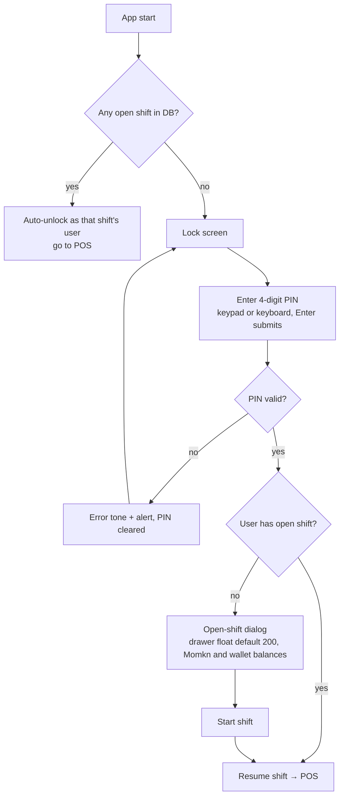
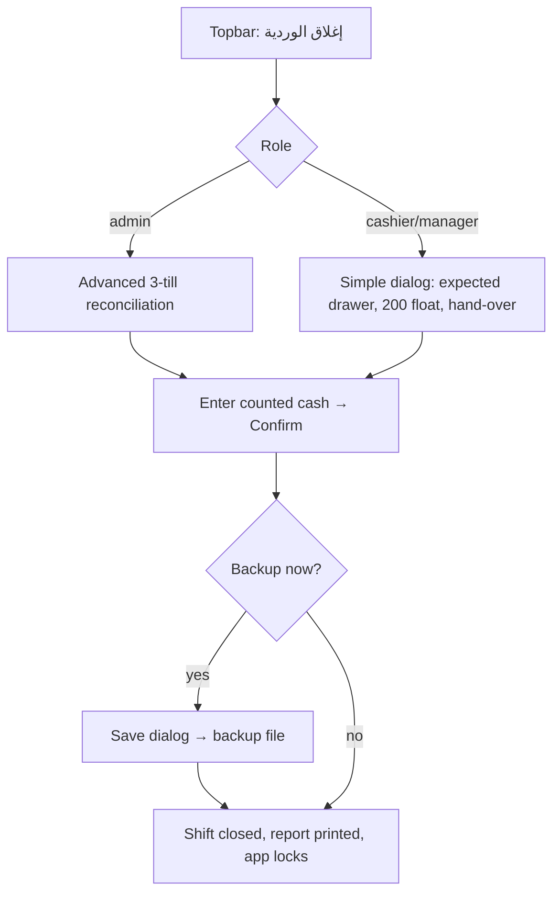

# User Flows

Keyboard reference (global, cashier screen, unchanged by the redesign): **F1** pay · **F2** focus search · **F3** focus first line quantity · **F4** delete last line · **Esc** clear cart (or close search) · **Ctrl+Alt+L** lock. Enter/Esc also dismiss alert dialogs.

## 1. Start of day: login and shift



Validation: negative opening amounts are ignored (no insert). The trigger blocks a second open shift for the same user (error alert).

## 2. Cashier sale (happy path)

```mermaid
sequenceDiagram
  actor Cashier
  participant UI as Cashier screen
  Cashier->>UI: Scan barcode (scanner field always focused)
  UI-->>Cashier: Line added / qty +1, row flashes, tone
  Cashier->>UI: (optional) F2 search → ↑/↓ → Enter
  Cashier->>UI: (optional) adjust qty with − / + or type; F3 jumps to first qty
  Cashier->>UI: (optional) discount, paid amount → change due shown
  Cashier->>UI: Choose payment method (cash default)
  Cashier->>UI: F1 or "تأكيد الدفع"
  UI-->>Cashier: Success toast, receipt printed (unless "بدون فاتورة"), cart reset, focus back to scanner
```

Error and edge paths:

| Situation                       | Behaviour                                           |
| ------------------------------- | --------------------------------------------------- |
| Unknown barcode                 | Error tone + red toast with the code; field cleared |
| Several suffix matches          | Matches appear in the search dropdown to pick from  |
| Empty cart + F1                 | Alert "السلة فارغة"                                 |
| No open shift + F1              | Alert asking to open a shift                        |
| Credit / split without customer | Alert; payment type not changed                     |
| Stock would go negative         | DB trigger aborts the whole sale; alert explains    |
| Printer failure                 | Sale is saved; alert describes the print error      |
| Qty field emptied / 0 on blur   | Line removed                                        |

## 3. Customer at checkout

Type name or phone → pick from autocomplete (shows phone, debt, points) → optional "use credit" if the customer has a credit balance → optional "save change as credit" when paid > due → optional delivery address. A new name not in the database creates a customer record at checkout.

## 4. Periodic drawer audit

Automatic after 1 h when idle ≥ 20 s with an empty cart, or from the topbar "جرد الدرج". Shows the expected-cash breakdown; cashier enters the counted cash → saved. Deficit → optional reason dialog. Snooze 5 min or skip for the hour.

## 5. End of shift



## 6. Returns (management → الفواتير والمرتجعات)

Search invoice (number, customer or date) → open → return quantity per line (≤ remaining) or return entire invoice → confirm → stock restored, refund recorded (drawer outflow, or debt reduction for credit sales) → optional reprint.

## 7. Customer repayment (management → العملاء والحسابات)

Search → open profile (stats, purchases, ledger, top products, period filter) → enter amount → if it exceeds the debt, confirm creating credit → ledger + drawer inflow.

## 8. Supplier purchase (management → الموردون والمشتريات)

Select supplier → add purchase (total, paid, payment type) → unpaid part becomes supplier debt; paid part is a drawer outflow. Repayments reduce the debt. **Stock is not changed by purchases.**

## 9. Products (management → الأصناف والمخزن)

Search (scanner input is routed here automatically), sort, paginate → add (scanner can fill the barcode) / edit (warning when retail < cost) / delete (blocked if the product was sold).

## 10. Navigation and recovery

- Sidebar items switch screens instantly; state of the cart is kept when visiting other screens.
- Lock (`Ctrl+Alt+L` / user menu) never closes the shift; logging back in resumes it.
- Render crashes show the ErrorBoundary screen with a reload button.
