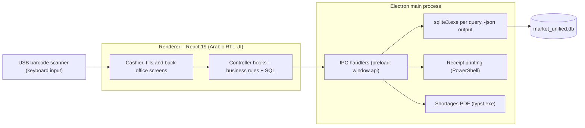

<div align="center">


# HeroMarket POS

**Offline-first point of sale and back office for a supermarket – Arabic, right-to-left, Windows desktop.**

[](https://github.com/Youssef2508/hero-market/actions/workflows/ci.yml)

</div>

---

## What it does

HeroMarket POS runs on the store's Windows PC and keeps everything in one local SQLite database, so selling never depends on the internet.

- **Cashier screen** – barcode scanner input (including price- and weight-embedded scale labels), instant product search (F2), quantity editing, amount discounts, five payment types (cash, Vodafone Cash, InstaPay, credit, partial payment), customer accounts with credit balance and loyalty points, delivery address, thermal receipts.
- **Shifts and tills** – opening floats for the drawer, the Momkn machine and mobile wallets; hourly drawer audits with deficit notes; simple and advanced (multi-till) shift close with a printed report.
- **Back office** – products and stock, reorder assistant, damaged goods, invoices and returns, customers, suppliers and purchases, cheques, expenses, users and roles, event log, backup and restore, KPIs, advanced reports and cashier performance.
- **Roles** – `cashier`, `manager`, `admin`, each with a 4-digit PIN.
- **Light and dark themes**, a right-side navigation sidebar, and keyboard shortcuts for the till: F1 pay, F2 search, F3 quantity, F4 remove last item, Esc clear invoice, Ctrl+Alt+L lock.

## Architecture



Details: [.docs/ARCHITECTURE.md](.docs/ARCHITECTURE.md) · [.docs/FRONTEND_ARCHITECTURE.md](.docs/FRONTEND_ARCHITECTURE.md) · [.docs/BUSINESS_LOGIC.md](.docs/BUSINESS_LOGIC.md)

## Quick start (development)

Requirements: Windows 10/11, Node.js 22, Git.

```powershell
git clone https://github.com/Youssef2508/hero-market.git HeroMarket
cd HeroMarket
npm ci
npm run db:init      # creates market_unified_testing.db with sample data (admin PIN 1234)
npm run dev
```

If Electron fails to start with `app` undefined, your terminal exports `ELECTRON_RUN_AS_NODE`; clear it first (`Remove-Item Env:ELECTRON_RUN_AS_NODE`). Full guide: [.docs/DEVELOPMENT_SETUP.md](.docs/DEVELOPMENT_SETUP.md).

## Scripts

| Command                                      | Purpose                                                         |
| -------------------------------------------- | --------------------------------------------------------------- |
| `npm run dev`                                | Run the app with hot reload                                     |
| `npm run lint` / `npm run format:check`      | ESLint / Prettier checks                                        |
| `npm run build`                              | Production build of main, preload and renderer                  |
| `npm test` / `npm run test:fresh`            | SQL simulation suites (copy of the installed DB / fresh DB)     |
| `npm run build:unpack` / `npm run build:win` | Unpacked app / unsigned NSIS installer in `dist/`               |
| `npm run icons`                              | Regenerate all icons from `resources/brand/heromarket-mark.svg` |

## Documentation

Engineering documentation lives in [`.docs/`](.docs/README.md): product overview, repository map, data model, business rules, UI design system, user flows, testing and known issues, Docker, CI/CD, security and releases, and the decision log. The older `docs/` folder is inherited from the original project.

## Project history

HeroMarket POS is developed from the open-source **Elnagdi POS** project (`3bkader-gpt/elnagdi-pos`), kept as the read-only `upstream` remote. Internal identifiers such as the package name and the `%APPDATA%\elnagdi-pos` data folder are kept on purpose so existing installations upgrade without losing data (see [.docs/DECISIONS.md](.docs/DECISIONS.md), D-005).

## License

No license file is included in this repository. The upstream project's README stated MIT; confirm the licensing and add a `LICENSE` file before distributing the software.
