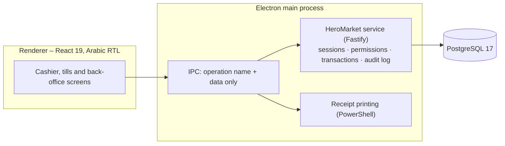

<div align="center">


# HeroMarket POS

**Point of sale and back office for Hero Market (هيرو ماركت) – Arabic, right-to-left, Windows desktop, PostgreSQL.**

[](https://github.com/Youssef2508/hero-market/actions/workflows/ci.yml)

</div>

---

## What it does

- **Cashier screen** – barcode scanner input (including price- and weight-embedded scale labels), instant product search (F2), quantity editing, amount discounts, five payment types (cash, Vodafone Cash, InstaPay, credit, partial payment), customer accounts with credit balance and loyalty points, delivery address, thermal receipts.
- **Shifts and tills** – opening floats for the drawer, the Momkn machine and mobile wallets; periodic drawer audits with deficit notes; simple and advanced (multi-till) shift close with a printed report.
- **Back office** – products and stock, reorder assistant, damaged goods, invoices and returns, customers, suppliers and purchases, cheques, expenses, event log, backup and restore, KPIs, advanced reports and cashier performance.
- **Roles and permissions** – dynamic roles built from a permission catalogue, enforced by the service on every operation (system administrator, store manager, supervisor, cashier, stock keeper, read-only auditor, or your own roles).
- **Store settings** – store name, branch, address, phone, logo, printer, paper size, drawer-audit rules.
- **Receipt designer** – 58 mm, 80 mm and A4/PDF templates. Every element (logo, store name, invoice number, date, customer, items, each total, free text, separators) can be placed at the top, middle or bottom and aligned right, centre or left, in bold or large type. The live preview shows exactly what the printer receives.
- **Light and dark themes**, keyboard shortcuts for the till: F1 pay, F2 search, F3 quantity, F4 remove last item, Esc clear invoice, Ctrl+Alt+L lock.

## Architecture



The renderer never sees SQL, database credentials or session tokens. The same service runs in three ways:

| Mode                   | For                   | Database                                                                                                     |
| ---------------------- | --------------------- | ------------------------------------------------------------------------------------------------------------ |
| **This computer only** | a store with one till | a private PostgreSQL that the app installs, starts and stops by itself (`%APPDATA%\HeroMarket\pgdata`)       |
| **Database server**    | the store's main PC   | a PostgreSQL server the store manages                                                                        |
| **Cashier terminal**   | additional tills      | none locally – the till talks to the HeroMarket server on the store network (`docker compose up`, see below) |

Details: [.docs/ARCHITECTURE.md](.docs/ARCHITECTURE.md) · [.docs/DATABASE_ARCHITECTURE.md](.docs/DATABASE_ARCHITECTURE.md) · [.docs/SECURITY_AND_RELEASE.md](.docs/SECURITY_AND_RELEASE.md)

## Quick start (development)

Requirements: Windows 10/11, Node.js 22 or newer, Git.

```powershell
git clone https://github.com/Youssef2508/hero-market.git HeroMarket
cd HeroMarket
npm ci
npm run pg:dev       # terminal 1: local development PostgreSQL (port 54329, data in .pgdata/)
npm run dev          # terminal 2: the app; first start asks you to create the administrator
```

If Electron fails to start with `app` undefined, your terminal exports `ELECTRON_RUN_AS_NODE`; clear it first (`Remove-Item Env:ELECTRON_RUN_AS_NODE`). Full guide: [.docs/DEVELOPMENT_SETUP.md](.docs/DEVELOPMENT_SETUP.md).

## Scripts

| Command                                      | Purpose                                                            |
| -------------------------------------------- | ------------------------------------------------------------------ |
| `npm run dev`                                | Run the app with hot reload                                        |
| `npm run pg:dev`                             | Start the development PostgreSQL cluster                           |
| `npm test`                                   | Unit + service/integration tests (needs PostgreSQL; fails if none) |
| `npm run test:unit` / `npm run test:service` | Only the database-free suites / only the PostgreSQL suites         |
| `npm run lint` / `npm run format:check`      | ESLint / Prettier checks                                           |
| `npm run build`                              | Production build of main, preload and renderer                     |
| `npm run build:unpack` / `npm run build:win` | Unpacked app / unsigned NSIS installer in `dist/`                  |
| `npm run db:import-sqlite`                   | Import a pre-PostgreSQL SQLite database with parity verification   |
| `npm run icons`                              | Regenerate all icons from `resources/brand/heromarket-mark.svg`    |

## Multi-till server (Docker)

```powershell
copy .env.example .env      # set POSTGRES_PASSWORD and HEROMARKET_SECRET
docker compose up -d        # PostgreSQL + HeroMarket server + HTTPS proxy on port 8443
docker compose logs server  # shows the one-time setup code for the first administrator
docker compose cp proxy:/data/caddy/pki/authorities/local/root.crt ./root.crt   # pinned by each till
```

Each till then chooses **Cashier terminal**, enters `https://<server-ip>:8443` and picks `root.crt`. See [.docs/DOCKER.md](.docs/DOCKER.md).

## Documentation

Engineering documentation lives in [`.docs/`](.docs/README.md): product overview, architecture, database architecture and migration, data model, business rules, security and permissions, UI design system, user flows, testing and known issues, Docker, CI/CD, production readiness and the decision log. The older `docs/` folder is inherited from the original code base and kept for reference.

## Project history and upgrades

HeroMarket POS started from an open-source point-of-sale code base, which developers can still fetch from the read-only `upstream` remote (pushing to it is disabled). It has since been rebuilt as HeroMarket POS: new design, PostgreSQL service, roles and permissions, receipt designer. A store that ran an earlier version has its data imported on first start after the upgrade, with every table and value verified. The old database file is only read, never modified, so going back to the previous version is still possible (see [.docs/DATABASE_MIGRATION.md](.docs/DATABASE_MIGRATION.md)).

## License

No license file is included in this repository. The original code base's README stated the MIT license, which requires its copyright notice to stay with distributed copies: confirm the licensing and add the `LICENSE` / notice file before distributing the software.
